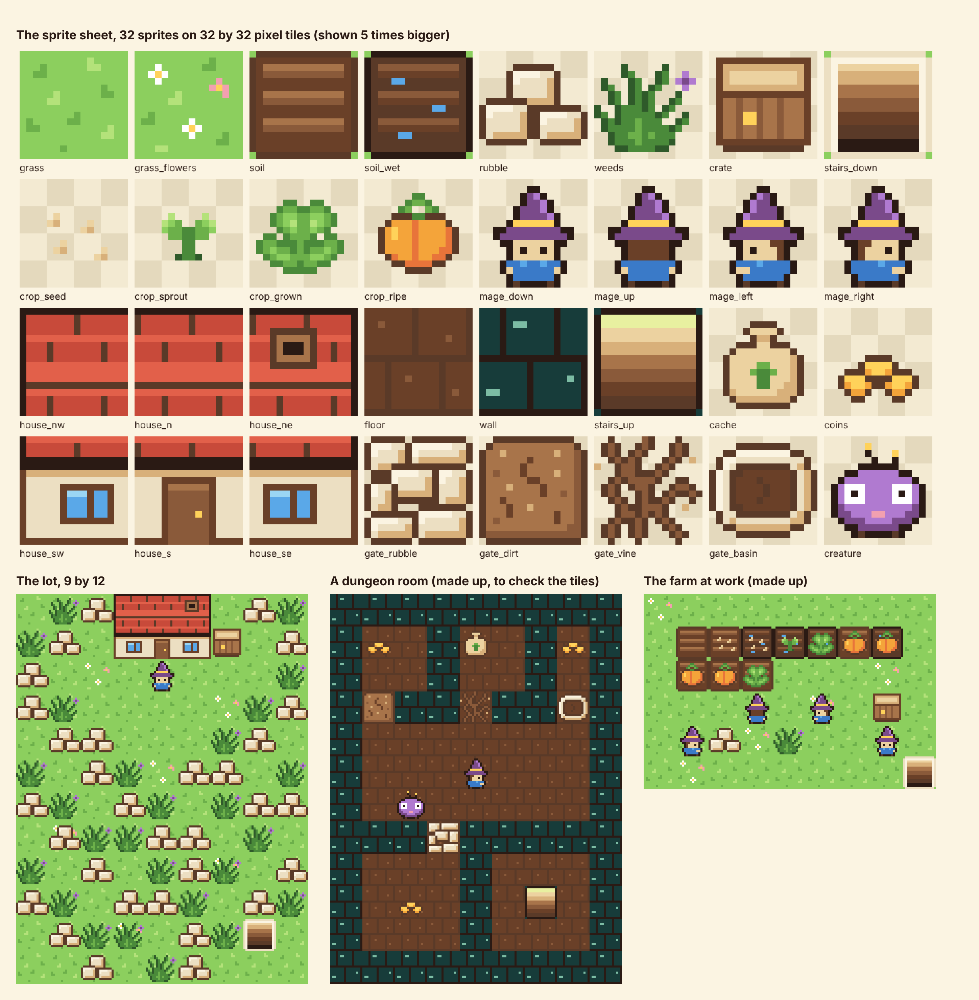

# bevyVgodot

One small phone game, built twice: once in Bevy and once in Godot. Both builds get the same ask, word for word. The score is how many asks each build needed.

The game is a cozy top-down farming game for an upright phone, played in the browser. It gets built in ten steps, from an empty folder to a prototype you can play.

## The score so far

| Step | Godot asks | Bevy asks | Fewer asks |
| --- | --- | --- | --- |
| 1. On your phone | 1 | 2 | Godot. Bevy's lot showed no art on a real phone and needed a fix-up |
| 2. Thumbs | 1 | 1 | a tie |
| 3. The first spell | 1 | 1 | a tie. A real phone played both and both sound good |
| 4. Soil and seeds | 1 | 1 | a tie |
| 5. Water | 1 | 1 | a tie |
| 6. Skills | 1 | 1 | a tie |
| 7. Sell, save, and a phone call | 2 | 1 | Bevy. The outside review found Godot's mouse did nothing on a touchscreen computer, and Godot needed a fix-up |
| 8. Down the stairs | 1 | 1 | a tie |
| 9. Something lives down here | 1 | 1 | a tie |
| **So far** | **10** | **10** | |

The build log in [`log/`](log/) has every ask word for word, what came back, what broke, the fix, the minutes and the download size.

## How the fight works

- **One ask, sent twice.** Each step's ask is written once, before the step, in plain words with no engine terms. Both builds get it word for word. The asks are in [`asks/`](asks/).
- **Two builders that can't see each other.** Each engine is built on its own by an AI builder, the same model at the same settings. Neither side sees the other's code or log. From step 4 each builder also has a machine of its own.
- **An ask is any message that changes a build.** That is the step's ask and every fix-up after it. A question that changes nothing is free.
- **Fix-ups say what a player sees.** When a build misses, its fix-up says only what is wrong on screen. It never says how to fix it.
- **Fewer asks wins the step.** The same count is a tie.
- **The engine and nothing else.** No plugins, add-ons, templates or game libraries on either side. Both builds start from an empty folder.
- **Shared art counts for neither side.** Both builds draw from the same sprite sheet and the same maps in [`shared/`](shared/). Loading and drawing them is each build's own work.
- **One referee.** The same browser checks in [`tools/`](tools/) run on both builds at phone and PC sizes and change nothing in either. A step's own check works the game the way a player would, with test touches, and reads the result from screenshots.
- **A real phone has the last word.** The test browser draws with software and a phone does not, so a build can pass the check and still be wrong on a phone. Step 1 showed that.

## What is where

| Folder | What is in it |
| --- | --- |
| [`asks/`](asks/) | The builder's brief, and each step's ask |
| [`shared/`](shared/) | The sprite sheet, the thumb stick's art, the lists of what is where on them, and the maps |
| `godot/` | The Godot 4.7.2 build |
| `bevy/` | The Bevy 0.20 build |
| [`log/`](log/) | The build log, one file a step |
| [`tools/`](tools/) | The script that draws the shared art, the referee's browser checks, and the packer for the play pages |

