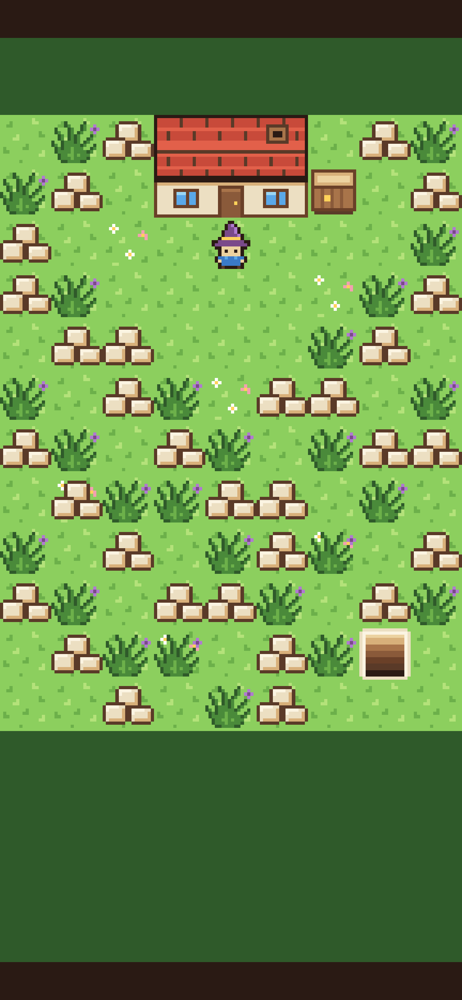
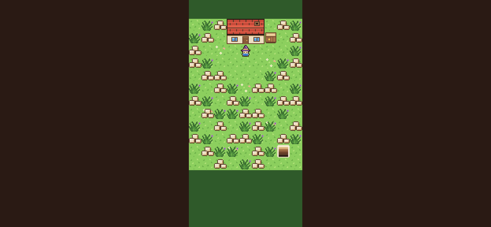
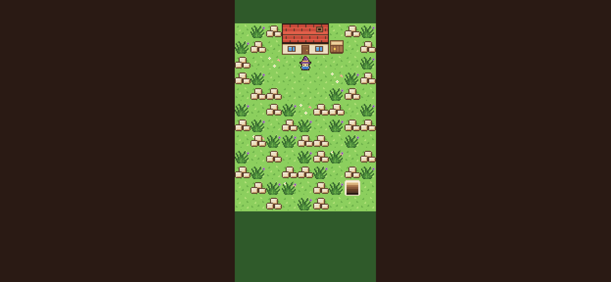

# Step 1: On your phone

**The ask:** [`asks/step-01.md`](../asks/step-01.md), sent word for word to both builders at 2:12 am Central on 11 November 2026, after [the builder's brief](../asks/builder-brief.md). Godot needed no second ask. Bevy needed a fix-up after both pages were opened on a real phone.

**Result: Godot wins the step, 1 ask to 2.** Both builds passed the referee's browser check on one ask each. Then both pages were opened on a real phone, which is the step's done-when line. Godot's lot was right. Bevy's lot showed none of its art, so Bevy got a fix-up, and a fix-up is an ask. See [On a real phone](#on-a-real-phone) below.

| | Godot 4.7.2 | Bevy 0.20.1 |
| --- | --- | --- |
| Asks | 1 | 2 |
| Asks so far | 1 | 2 |
| Builder's time, from the first ask to its report | 12 min 38 s | 47 min 52 s |
| Builder's work, in tokens | 135,524 | 278,723 |
| Builder's tool calls | 37 | 108 |
| What the builder wrote | 244 lines in 8 files | 485 lines in 8 files, plus a lock file |
| Download from a plain host | 39.8 MB in 7 files | 13.8 MB in 3 files |
| The same, with the big file gzipped | 10.5 MB | 4.4 MB |
| Biggest file | the engine, 39.5 MB | the game and engine in one file, 13.7 MB |
| The game's own part of that | 15 KB | not separate |
| One build from nothing | 9 seconds | about 9 minutes |
| One build after a change | 9 seconds | about 6 minutes |
| Seconds to the cover in the check browser | 3 to 5 | 3 to 7 |

The times and token counts are what the builders' own runs reported. Godot's build time was timed by the referee. Bevy's two build times are its builder's own figures and were not timed again.

## The referee's check

The same check, [`tools/check-web.cjs`](../tools/check-web.cjs), ran on both web folders: served like a plain web host, opened in headless Chromium at five sizes, one tap or click, and each screenshot measured against a picture drawn straight from the shared files. The numbers are in [`step-01/godot-check.json`](step-01/godot-check.json) and [`step-01/bevy-check.json`](step-01/bevy-check.json).

| Checked | Godot | Bevy |
| --- | --- | --- |
| The cover shows, in the right color, with the words centered | yes, at all five sizes | yes, at all five sizes |
| The words are about one tile tall | 1.00 tile | 0.95 tile |
| One tap takes the cover away | yes | yes |
| The picture is the right shape, as big as fits, centered | yes | yes |
| Everything outside the picture is `#2a1a14` | 100% | 100% |
| The lot matches the shared files, upright phone (390 by 844) | all but 0.01% of pixels | all but 0.32% of pixels |
| The same, phone with browser bars (390 by 664) | all but 0.24% | all but 0.21% |
| The same, phone turned sideways | all but 2.24% | all but 2.61% |
| The same, small phone (360 by 640) | all | all |
| The same, PC (1280 by 720) | all but 1.70% | all but 3.64% |
| Fits again after the window changes size | yes | yes |
| Page errors or missing files | none | none |

The pixels that differ are on the rims of sprite pixels, where a size that is not a whole multiple has to round one way or the other. Looked at up close, both builds are sharp and even.

| | Godot | Bevy |
| --- | --- | --- |
| The cover |  |  |
| The lot |  |  |
| Sideways |  |  |

One visible difference: the words on the cover. Each build used its engine's built-in font, because the shared folder has none. Godot's is a plain sans. Bevy's is a typewriter face.

## Godot: what came back

A project of four short scripts and one scene: one script fits the picture to the screen, one reads the sprite sheet, one lays out the lot, one takes the cover away. The build command copies the shared files in and exports the web folder.

What went wrong on the way, by the builder's own report:

1. Its own check waited for the loading screen to be hidden, but the engine's page removes it. It changed the wait.
2. The picture sat one or two screen pixels off center, because the engine snaps its layout boxes to whole pixels. It moved the picture to a plain 2D node.
3. The words sat a little low because of the tails of the p and the y. It moved them up 3 pixels.

Two things it did that the ask did not say: it switched off the engine's logo on the loading screen and made that screen `#2a1a14`, and it named the project "Farm", which shows as the page's title.

## Bevy: what came back

Five source files: the picture and its fitting, the sprite sheet, the lot, the cover, and the start. The shared files are read by the compiler and travel inside the one game file, so there is no loading wait after the download. Besides the engine it uses only a JSON reader.

What went wrong on the way, by the builder's own report:

1. The engine's newest 0.20 release asks for a slightly newer Rust than the machine had (1.97.1 against 1.97.0). It builds with a flag that ignores that, and it compiles and runs.
2. One download-shrinking setting made the next tool reject the file. It took the setting out and let that tool do the shrinking.
3. Letters looked soft, because the engine draws them without regard to the camera. The game now asks for letters at their on-screen size. That in turn kept a set of letters for every window size seen, and memory grew from 17 MB to 91 MB while the window was dragged. It now drops the old sets and stays at 17 MB.
4. A sprite's neighbor on the sheet could show along a tile's rim. Each sprite is now cut a hair inside its edges.
5. In its own check, the test browser's phone setting gave the game a canvas with one pixel for each CSS pixel, which looked uneven. It tested again at a true 3 screen pixels for each CSS pixel, and asked the page never to smooth a stretched canvas.

One thing it could not check: until the 13.7 MB file arrives the page is plain `#2a1a14`, with no loading sign.

## The referee's own miss

The first run of the referee's check used the test browser's phone setting alone. That setting tells a page its canvas has one screen pixel for each CSS pixel, which no real phone does. Godot sizes its canvas another way and was not affected. Bevy was, and its sprite pixels came out uneven in that run (3% to 10% of pixels off). The check now starts the browser at a real screen's pixel density, and both builds were run again. The numbers above are from that second run. No ask was sent because of it.

## On a real phone

Both play pages were opened on a real phone at 8:24 am Central on 11 November 2026, six hours after the builds came back.

| | Godot | Bevy |
| --- | --- | --- |
| The page loads, and the cover shows | yes | yes |
| One tap takes the cover away | yes | yes |
| The picture fills the screen upright, with both strips | yes | yes |
| The lot shows its art | yes | **no** |

On the phone, every tile of Bevy's lot was one flat color. The grass was plain light green with no tufts and no flowers. The house was six plain blocks, dark brown and red. The rubble, the weeds, the crate, the stairwell and the mage did not show at all. The person holding the phone called it a green screen with a few shapes in other colors.

The referee's check had passed this same build, and it still does: in the test browser the art is all there. The test browser draws with software. A phone draws with its graphics chip. So the check can't see this fault, and it can't confirm a fix for it either. Only the phone can.

### Bevy's fix-up (its second ask)

Sent to the Bevy builder at 8:29 am Central, with the phone's screenshot. Like every fix-up, it says what a player sees and nothing about how to fix it. Word for word:

> Fix-up for step 1, from a real phone.
>
> On a real phone, after the tap, the lot shows none of its art. Every tile is one flat color. The grass is plain light green, with no tufts and no flowers. The house is six plain blocks: the top three and the bottom left one are dark brown, and the bottom middle and bottom right ones are red. The rubble, the weeds, the crate, the stairwell and the mage do not show at all. The two strips, the bars at the sides, and the picture's size and place are right.
>
> A screenshot from the phone is at `/home/user/ring-bevy/reports/step-01-on-a-real-phone.jpg`. As far as I know it is an Android phone. In the test browser on this machine the same page shows the art as it should.
>
> It is done when the lot shows all of its art on a real phone. Reply with the same kind of short report as before.

### What came back

The report came back at 9:02 am Central, after 33 minutes 11 seconds of builder time (163,179 tokens, 50 tool calls). The change is one short piece of code, 34 lines in one file.

The builder's own account: the engine draws every sprite on one shared square, packs that square's corners into small numbers, and unpacks them while drawing. On the phone the unpacked value for "where on the image is this corner" came out as zero, so every sprite showed only its top-left pixel, stretched over the tile. That is one flat color for the grass and the house, and nothing at all for the sprites whose corner pixel is see-through. The builder could not make the test browser fail by itself. It forced that one value to zero in the old build and got the phone's picture tile for tile. Then it swapped the engine's packed square for the same square in plain numbers, and with the same zero forced, the new build shows all the art.

It is a diagnosis from one screenshot, and the builder says so. It has no phone.

| After the fix-up | Bevy |
| --- | --- |
| The referee's check | passes, with the same numbers as before, to the hundredth of a percent |
| Download from a plain host | 13.8 MB in 3 files, 2 KB more than before |
| The same, with the big file gzipped | 4.4 MB |
| Memory in the test browser, by the builder's figure | 20.6 MB, up from 17.1 MB. It did not chase why |

The fixed build went onto Bevy's play page at 9:05 am Central. Whether the art shows on a real phone is not known yet.

One thing the builder reported that is the referee's to own: while it looked for its own local server, a list of running programs showed it the command line of the referee's check, which was running on a stand-in page at the time. The builder says it opened nothing there. The command line names the check's script and a folder. It holds none of the other build's code.

## Not checked

- An iPhone's browser in particular.
- How long either download takes on a phone network.
