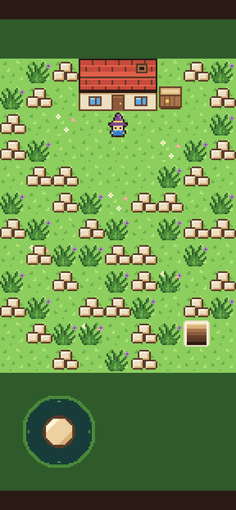
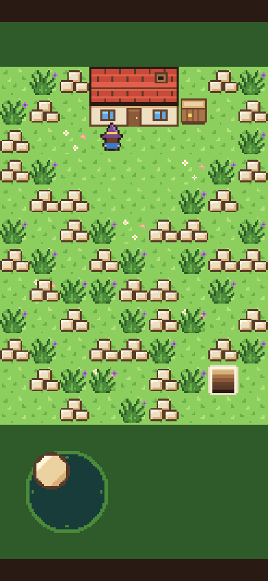
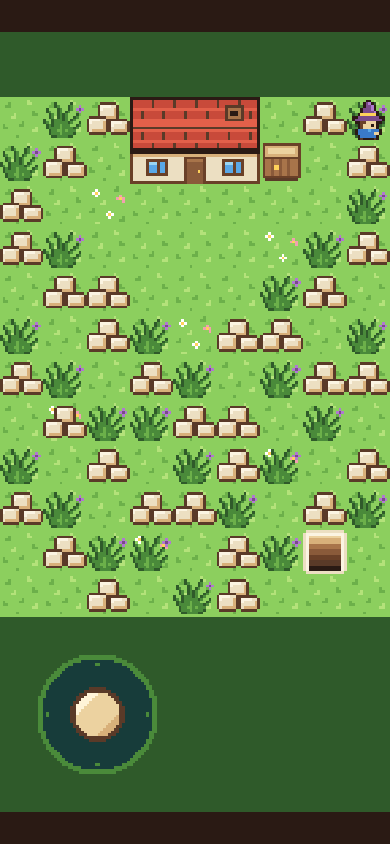
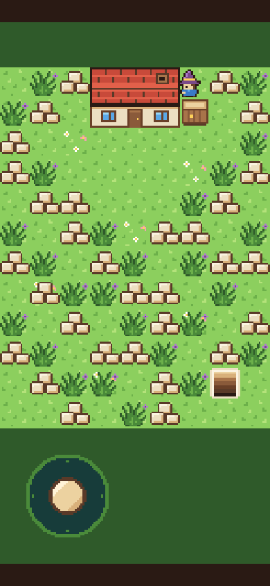

# Step 2: Thumbs

**The ask:** [`asks/step-02.md`](../asks/step-02.md), written once and sent word for word to both builders on 11 November 2026. Godot got it at 8:34 am Central. Bevy got it at 9:03 am, when its fix-up for step 1 was back (see [step 1's log](step-01.md)). Each message ended with one more line, the same for both: "Reply with the same kind of short report as before."

**Result so far:** Godot passes the referee's check on one ask. Bevy was still building when this was written. The step closes when the mage has walked to all four corners under a thumb on a real phone, in both builds.

| | Godot 4.7.2 | Bevy 0.20.1 |
| --- | --- | --- |
| Asks for this step | 1 | not back yet |
| Asks so far | 2 | |
| Builder's time, from the ask to its report | 64 min 32 s | |
| Builder's work, in tokens | 311,299 | |
| Builder's tool calls | 47 | |
| What the build is now | 428 lines in 10 files (244 in 8 after step 1) | |
| Download from a plain host | 39.9 MB in 7 files, 6 KB more than step 1 | |
| The same, with the big file gzipped | 10.5 MB | |
| The game's own part of that | 22 KB | |
| One build after a change | 9 to 12 seconds | |

The times and token counts are what the builders' own runs reported.

## What the ask left to the builder, and what it pinned down

The ask gives numbers wherever a player could tell two builds apart, so the check can be the same for both: where the stick sits (its middle 72 pixels in from the left and 72 below the top of the bottom strip), how far the knob travels (28 pixels), how far it must be pushed before the mage moves (more than 8), the mage's speed (96 pixels a second, 3 tiles), the size of the mage for bumping (a 20 by 20 pixel box), and what is solid (the house, the crate and the lot's edge). Rubble and weeds are not solid yet, or the mage could not reach the corners. How to do any of it is the builder's.

The stick's art is shared, like the sprite sheet: [`shared/controls.png`](../shared/controls.png), drawn by the same script.

## The referee's check

[`tools/check-step-02.cjs`](../tools/check-step-02.cjs) opens a build in headless Chromium, works the stick with real touch events (and the mouse and the keys at PC size), and reads where the mage and the knob are from screenshots alone. It knows nothing about either engine. It tries 83 things in five views. Step 1's picture check, [`tools/check-web.cjs`](../tools/check-web.cjs), runs too, now with the stick in its picture.

| Checked | Godot | Bevy |
| --- | --- | --- |
| The stick is drawn where the ask says, sharp, and the picture still matches the shared files | yes, at every size | |
| The knob follows the thumb, stops 28 pixels out, and goes back when the thumb lifts | yes | |
| The mage stands still at 6 pixels and walks at 12 | yes | |
| All four corners reached, and the mage can't leave the lot | yes | |
| The house and the crate stop the mage, from every side tried | yes, flush each time | |
| Pushed at a slant against a wall, the mage slides along it | yes | |
| The mage faces the way it walks, at nine slants, and keeps its facing | yes | |
| Speed with the stick, straight and at a slant (96 pixels a second asked) | 94 and 95 | |
| A thumb that slides off the strip, or off the picture, keeps hold | yes | |
| A touch that starts anywhere else does nothing | yes | |
| A second finger doesn't disturb the thumb | yes | |
| A tap on the cover where the stick will be doesn't move the mage | yes | |
| The mouse works the stick | yes | |
| Arrow keys and W, A, S, D, alone and two at a time | yes, all 12 tried | |
| Speed with keys, straight and at a slant | 98 and 102 | |
| The page did not scroll, zoom or select anything | yes | |
| Page errors | none | |
| Things passed | 83 of 83 | |

The speeds are measured from screenshots and are good to a few pixels a second.

| | Godot | Bevy |
| --- | --- | --- |
| The start |  | |
| A thumb held up and left |  | |
| The top right corner |  | |
| In the gap between the house and the crate |  | |

The numbers are in [`step-02/godot-check.json`](step-02/godot-check.json).

## Godot: what came back

Two new scripts, one for the stick and one for the mage, and small changes to five other files. The stick script takes the first touch that starts in its half of the strip and follows only that touch. The mage script moves across first and then down, in hops of 8 pixels at most, and backs up to the tile line when a hop lands in something solid. The mouse is switched on as a touch in the project's settings, so the game handles one kind of input.

What went wrong on the way, by the builder's own report:

1. Under a thumb, an even slant faced down. Dividing the touch's place by the screen's zoom left tiny rounding errors, so even was never quite even. It added a tolerance of about a twelfth of a degree.
2. Two mistakes in its own tests, not in the game: lifting one of two fingers the wrong way, and reading screenshots while keys were still held.
3. The referee's housekeeping note arrived mid-step (see [step 1's log](step-01.md)). It moved its test files into its own folder.

Choices the ask left open, as the builder made them:

- The mage faces the way it is pushed, even while a wall stops it.
- Nothing runs under the cover. Keys pressed before the tap do nothing.
- A second finger that lands on the stick's half while the stick is held never takes hold, even after the first lifts.

The builder ran 134 checks of its own. Most of its 64 minutes went there: the game was first built seven minutes in.

One thing it left behind: a local test server it could not stop without listing running programs, which the note had just told it not to do. It said so in its report, and the referee stopped it.

## Bevy: what came back

Not back yet.

## The referee's own misses

- **The check walked too slowly to judge.** The test browser draws with software. At a phone's real sharpness, three screen pixels to a point, it drew Godot's build at 5 to 7 frames a second and Bevy's step 1 build at 2. No phone is that slow. A push that should end between two frames ran long, the mage overshot, and the first run of the check showed 8 misses for Godot that were the check's, not the build's. The check now does its walking at phone size with one screen pixel to a point, where the test browser keeps up (29 frames a second for Godot). It measures the frames a second in every view, allows for them wherever a check turns on timing, and uses walls instead of timing to put the mage where a test needs it. One view still runs at the real sharpness. No ask was sent because of this.
- **Two keys never lift in the same instant.** The check read the mage's facing after two keys were let go. The key that lifted last turned the mage its own way for one frame, which is right, and the check called it a miss. It now reads the facing while the keys are down. No ask was sent because of this either.
- The check was tried on a plain stand-in page first, written by the referee from the same ask, and on a copy of that page with faults put in, to see that it passes what is right and catches what is wrong.

## Not checked

- A real phone. That is the done-when line.
- Whether a real phone's browser scrolls, zooms or brings up a menu when a thumb drags on the game. The test browser can't show that.
- An iPhone's browser in particular.
