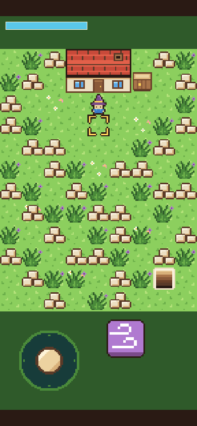
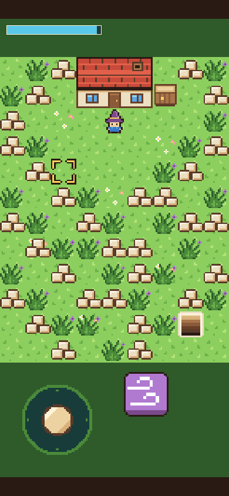
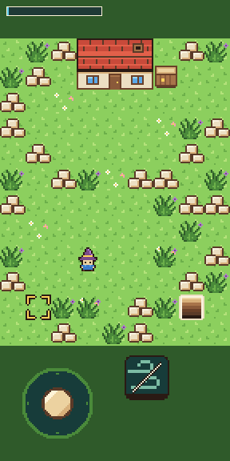
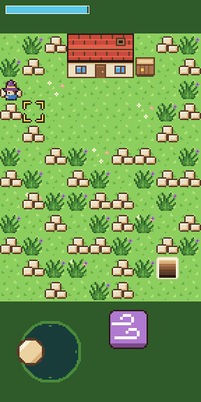

# Step 3: The first spell

**The ask:** [`asks/step-03.md`](../asks/step-03.md), written once and sent word for word to both builders at 10:19 am Central on 11 November 2026. Each message ended with one more line, the same for both: "Reply with the same kind of short report as before."

**Result: a tie at one ask each.** Both builds pass all 151 things the referee's check tries, and neither needed a second ask. The step's done-when line ends "and you hear it on your phone", and nobody has heard either build on a real phone yet. Godot's play page has had step 3 since 12:38 pm Central and Bevy's since 1:03 pm. If the phone agrees, the score after three steps is Godot 3 asks, Bevy 4.

**Added at 2:53 pm Central the same day:** a real phone has now played both play pages, Godot's at step 6 and Bevy's at step 4, and the word back was that both sound good. That was the open part, so the step is closed as a tie. What follows is the log as it was written while that try was still open.

## For the short

The numbers and the moments from this step that are worth telling. Everything here is from the log below.

- **The score:** a tie, one ask each. So far: Godot 3 asks, Bevy 4.
- **Four minutes of code, two hours of testing.** Godot's builder last touched the game's own files 4 minutes after the ask. Bevy's had the game written 7 minutes in and made its last change, to the sound, 38 minutes in. Godot's report came 2 hours 6 minutes after the ask and Bevy's 2 hours 20 minutes after. The rest was each builder testing its own work, on one machine they shared with each other and with the referee.
- **Bevy's first sound was wrong, and its builder caught it by measuring.** The engine played the first 23 thousandths of a second of every sound too fast, at more than twice the pitch. The soft "no" starts at its loudest, so its attack was plainly off. The builder put a short silence in front of each sound, inside the engine's own sound hook, and the sound then matched the file sample for sample.
- **Bevy's sound did not switch on at all at first.** The page's code that wakes the sound on the first tap ran too late to see the engine's sound output. It moved into its own small script above the game's.
- **Godot's scare was a false alarm.** Its builder first measured Gust at 1.18 of full loudness, which would distort. The fault was in its own measuring. Per speaker it is 0.84.
- **Sound added half a megabyte to Bevy and almost nothing to Godot.** Bevy's download grew by 524 KB, nearly all of it the engine's sound code. Godot's grew by 44 KB, because its sound code was already inside its 39.5 MB engine file. The totals: 39.9 MB and 14.3 MB, or 10.6 MB and 4.6 MB the way a host that compresses sends them.
- **How soon you hear it, in the test browser:** at the playing size Godot's sounds start 23 to 49 thousandths of a second after the touch and Bevy's 123 to 160. The test browser draws Bevy's page more slowly (40 frames a second against 61), and Bevy mixes its sound on the same thread that draws.
- **Bevy's sound falls apart when the page draws slowly. Godot's does not.** The referee's check heard it at five more screen sizes, where the test browser draws more slowly. Godot's Gust was the same sound every time, down to 6 frames a second. Bevy's was clean at 29 frames a second, came out louder than full and cut short at 17 and 18, and at 4 frames a second started 1.4 seconds late and dragged on for 1.9 seconds. No phone should be as slow as the test browser, so this is a thing to listen for, not a miss.
- **Bevy's builder's own warning:** on a phone that draws fewer than about 30 frames a second, Bevy's sound will crackle and lag. It measured 4 late blocks of sound in 118 at 40 frames a second, 40 in 132 at 22, and all of them at 12 and under. The only fix it knows is to go around the engine, which the rules don't allow. A real phone will say whether it matters.
- **Code:** 644 lines in Godot, 1,427 in Bevy, for the same game. After step 2 it was 428 and 924.
- **The same answer, apart:** both builders let a new cast's sound play over the last one, and neither cuts the first short.
- **The referee's own misses, four of them this step.** The check's ears were deaf for a moment after every touch. It missed the first sound a page ever played. Its hands were too slow for Bevy's page. And on the busy machine its test of a cast with too little mana ran out of rubble before it got there. None of these cost either build an ask. They are told below.
- **A change of ring.** From step 4 on, each builder works in a thread of its own, on a machine of its own, so their tests stop waiting on each other.
- **Clips:** a film of each build doing the step is saved with the project's files (`clips/godot-step-03.mp4`, 44 seconds, and `clips/bevy-step-03.mp4`, 58 seconds). The same moves take Bevy longer in the test browser.
- **Pictures:** four screenshots of each build are in [`step-03/`](step-03/).

| | Godot 4.7.2 | Bevy 0.20.1 |
| --- | --- | --- |
| Asks for this step | 1 | 1 |
| Asks so far | 3 | 4 |
| Builder's time, from the ask to its report | 2 h 6 min | 2 h 20 min |
| Last change to the game's own files | 4 minutes in | 38 minutes in |
| Builder's work, in tokens | 218,613 | 380,193 |
| Builder's tool calls | 83 | 102 |
| What the build is now | 644 lines in 14 files (428 in 10 after step 2) | 1,427 lines in 14 files, plus a lock file (924 in 10 after step 2) |
| Download from a plain host | 39.9 MB in 7 files, 44 KB more than step 2 | 14.3 MB in 3 files, 524 KB more than step 2 |
| The same, with the big file gzipped | 10.6 MB | 4.6 MB |
| The game's own part of that | 66 KB | not separate |
| The builder's own checks before it reported | 231 (97 new, 134 from before) | 277 (121 new, 156 from before) |

The times, token counts and tool calls are what the builders' own runs reported. The last change to the game's files is from the files' own clock times.

## What the ask pinned down

Mana is 100 at the start, comes back at 6.5 a second by the clock, and shows as a bar 118 pixels long. One tile is aimed at: the one in front of the mage, or any tile within 2 that the player touches. Gust costs 8, clears rubble or weeds from the aimed tile and plays `gust.wav`. A cast that would change nothing costs nothing and plays the soft `no.wav`. With less than 8 mana the button shows its dim picture and a touch on it does nothing at all, with no sound. The button's art, the aim mark and the two sounds are shared and made in code, like the sprite sheet.

## The referee's check

[`tools/check-step-03.cjs`](../tools/check-step-03.cjs) opens a build in headless Chromium, plays it with real touch events (and the mouse and the keys at PC size), reads the picture from screenshots, and listens to what the page sends to the speakers. It knows nothing about either engine. It tries 151 things in six views, and films a seventh. Before either build saw it, it was tried on a plain stand-in page written from the same ask, and on 17 copies of that page with one fault each. It caught all 17.

| Checked | Godot | Bevy |
| --- | --- | --- |
| No sound before the tap that takes the cover away | yes | yes |
| The mana bar, the aim mark and the Gust button are drawn where the ask says, at every size | yes | yes |
| The aim mark is in front of the mage for all four facings, and gone at the lot's edge | yes | yes |
| A touch within 2 tiles aims there, a touch farther away does nothing | yes | yes |
| The mark lets go when the mage turns or walks off its tile | yes | yes |
| Gust clears rubble and weeds, costs 8, and plays the Gust sound | yes | yes |
| A cast at grass, a cleared tile, the house, the crate or no tile costs nothing and plays the "no" sound | yes | yes |
| Two thumbs: the stick held while another thumb aims and casts | yes | yes |
| The stick's thumb, slid over a tile or the button, does not aim or cast | yes | yes |
| Holding the button casts once | yes | yes |
| 16 casts in a row each clear their tile, and the bar shows what 8 a cast and 6.5 a second make | yes | yes |
| Under 8 mana the button is dim, and a cast changes nothing and makes no sound | yes | yes |
| Mana comes back at 6.5 a second | 6.49 | 6.65 |
| And at the same rate with the page slowed three times | 6.54 | 6.54 |
| The 1 key casts and a mouse press aims, at PC size | yes | yes |
| Steps 1 and 2 still stand: the picture, the stick, the corners, the house and the crate | yes | yes |
| The page did not scroll, zoom or select anything | yes | yes |
| Page errors | none | none |
| Things passed | 151 of 151 | 151 of 151 |
| How long after the touch a sound starts, at the playing size | 23 to 49 ms | 123 to 160 ms |
| Loudest the Gust sound got at the playing size, where 1 is full | 0.84 each time | 0.80 each time |
| Loudest the "no" sound got at the playing size | 0.45 | 0.45 |
| Frames a second in the test browser, at the playing size | 61 | 40 |

The shared sound files, played through the same meter in a page of the referee's own, read 0.83 for Gust, lasting 0.38 seconds, and 0.45 for "no".

The check also casts one Gust at each of the other screen sizes, where the test browser draws more slowly. It asks only that there is a sound, so all of these passed. What the meter heard:

| Screen size | Godot: frames a second | Godot's Gust | Bevy: frames a second | Bevy's Gust |
| --- | --- | --- | --- | --- |
| Small phone | 60 | 0.84 loud, 0.42 s long, 41 ms after the touch | 29 | 0.80 loud, 0.38 s long, 177 ms after the touch |
| Phone | 61 | 0.84, 0.40 s, 60 ms | 18 | 1.01, 0.36 s, 226 ms |
| Phone sideways | 36 | 0.84, 0.40 s, 49 ms | 17 | 1.22, 0.36 s, 186 ms |
| PC window, by the 1 key | 35 | 0.84, 0.41 s, 32 ms | 17 | 1.41, 0.30 s, 162 ms |
| Phone at its real sharpness | 6 | 0.84, 0.42 s, 784 ms | 4 | 1.41, 1.92 s, 1,395 ms |

Godot's sound is the same at every speed, and only starts late when the page crawls. Bevy's is right while the page draws about 30 frames a second or more. Below that it comes out louder than full, which a speaker clips, and shorter than the file, and at 4 frames a second it is late and stretched. This is what Bevy's builder warned of in its report. The test browser draws with software and is far slower than a phone at these sizes, so it does not say what a phone will do. It is something to listen for there.

| | Godot | Bevy |
| --- | --- | --- |
| The start |  |  |
| A Gust has cleared the rubble |  |  |
| Out of mana: the button is dim |  |  |
| Two thumbs: walking and casting |  |  |

The numbers are in [`step-03/godot-check.json`](step-03/godot-check.json) and [`step-03/bevy-check.json`](step-03/bevy-check.json).

## Godot: what came back

Four new scripts, for the mana bar, the aim mark, the spell button and the sounds, and small additions to four other files. The button script takes its spell's name, cost and key from the scene, so the next spell is another button and one more function. Each cast starts its sound from the beginning, and up to 8 of the same sound can play over each other.

What went wrong on the way, by the builder's own report:

1. Its first loudness reading for Gust was 1.18 of full. The fault was its own listening tap, which mixed the two speaker channels wrongly. Measured per channel it is 0.84.
2. The machine was busy, so a different timing check of its own failed on each run, each off by about one stalled frame. It changed its walking checks to count by the page's own frame times. The walking code is untouched from step 2.
3. A few mistakes in its own tests: one waited forever for mana to drop, and others walked the mage into the house or the lot's edge.
4. As in step 2, the engine counts at most about 0.13 seconds for one frame, so under about 7.5 frames a second mana and walking run slow.

Things it told the referee without being asked: the six sounds for later steps (about 25 KB) ride along in the game's pack, because its build copies the whole shared folder, and the game does not load them.

## Bevy: what came back

Four new source files, for the aim, the mana, the spell and the sound, and changes to six others. The two sounds are read from the shared folder when the game is built and travel inside the one .wasm file. The engine gained its sound part, which is most of the 524 KB the download grew by.

What went wrong on the way, by the builder's own report:

1. The sound never switched on. Its page put the code that wakes the sound in the same script that loads the game, and the game's script takes hold of the browser's sound before that code runs. The code now sits in its own plain script above the loader.
2. The engine plays the start of every sound wrong. It reads the first 512 samples of anything it starts as if there were 48,000 a second, so the first 23 thousandths of a second of these files came out in 11, at over twice the pitch. The builder gave each sound a short silent lead-in through the engine's own custom-sound hook. The sound now matches the files sample for sample and starts 11 thousandths of a second later.
3. Three of its old key checks missed in one full run on the busy machine. It measured the game against the key time the page itself saw, found it right to within a frame, and loosened its own check.

What it could not settle, and said so: the engine mixes sound on the same thread that draws, in blocks of 46 thousandths of a second handed over at most 45 ahead. So when the page draws slowly, blocks arrive late. It counted 4 late blocks in 118 at about 40 frames a second, 40 in 132 at 22, 79 in 141 at 16, and all of them at 12 and under, where the sound runs up to 15 seconds behind. A phone that holds 30 frames a second or more should be clean. It left it as it is, because the only fix it knows is to play sounds through the browser and not the engine, and the rules say the engine does the game's work.

It also checked that memory holds steady through 600 casts.

## The referee's own misses

None of these cost either build an ask. Each was found and fixed in the check before a build was judged by it, or on a run that was then thrown away.

- **Deaf for a moment after every touch.** The check first listened with a timer in the page. The test browser holds a page's timers back for about a seventh of a second after a touch starts, which is exactly when a cast's sound begins. The check now listens inside the browser's sound thread, which is not held back, and stamps what it hears with the clock time.
- **It missed the first sound a page ever played.** The listener was still loading when the first sound came. A second, simpler listener now runs from the very start and fills that gap.
- **Its hands were too slow for Bevy's page.** The check waited for the page to answer each touch before sending the next. Godot's page answers in about 40 thousandths of a second in the test browser and Bevy's in about 80, so the same 16 casts took Bevy's page half as long again, the mana came back faster than the check could spend it, and the check ran out of rubble before the mana ran out. That is the test browser, not a phone, and not the build. The check now casts with two thumbs by the clock, 260 thousandths of a second a cast, the same on both pages.
- **The cast with too little mana could not be set up on a busy machine.** With both builders still testing on the same machine, the check's screenshots came back late and its reckoning of the mana went wrong. Godot's first run showed 147 things passed and 3 not judged. The check now reckons the mana by the clock while it casts, and counts its try only when the screenshots prove the mana was under 8 at the cast. On the quiet machine both builds passed all 151.
- **The project's shared folder changes pictures and sounds.** Getting the new builder threads their files, the referee found that pictures and sounds copied into the project's shared folder come out a few thousand bytes bigger, with something added inside the file. Packed files come out untouched. So art and sound travel to the builders packed. No builder saw a changed file.

## A change of ring, from step 4

Through step 3 both builders ran on one machine, each in a folder the other could not see, with the referee's checks running beside them. Their own tests kept waiting on each other: that is most of this step's two hours. From step 4 each builder is a thread of its own with a machine of its own. Each new builder starts from its engine's folder as the builder before it left it, with that builder's tests and its reports for steps 1 to 3. It is told to stay out of everything else, and it hands its work back as packed files. It never sees this repository, the referee's checks or the other build. The asks still go word for word to both, and an ask still counts the same way.

## Not checked

- Hearing either build on a real phone. That was the open part of this step when the log was written. It closed the same afternoon: both sound good on a real phone.
- Whether the first tap wakes the sound on a real phone's browser. The test browser has no such lock.
- How Bevy's sound holds up on a phone that draws slowly.
- Real fingers on the Gust button.
