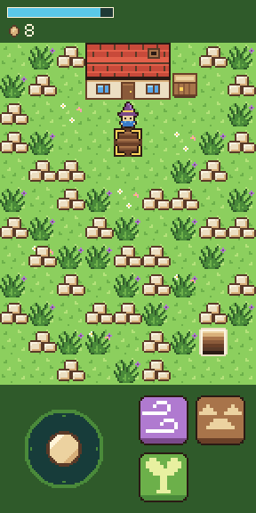
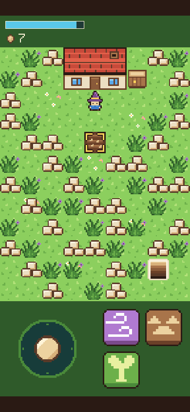
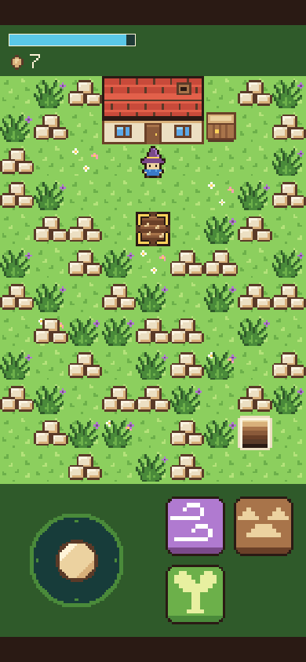
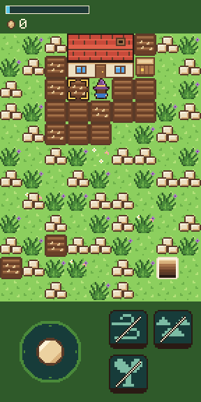
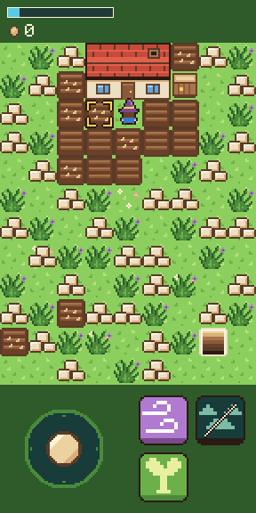
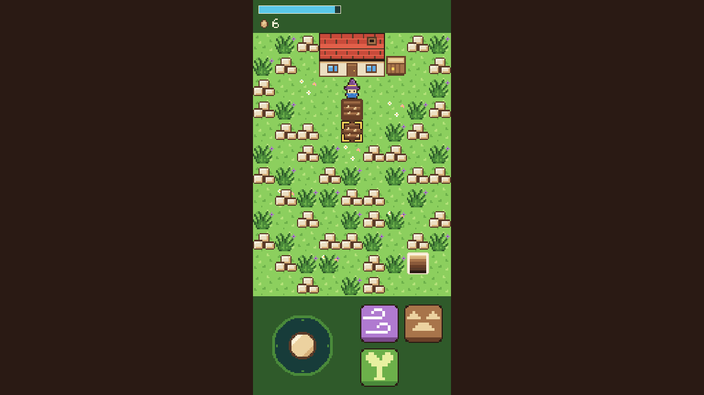

# Step 4: Soil and seeds

**The ask:** [`asks/step-04.md`](../asks/step-04.md), written once and sent word for word to both builders on 11 November 2026: to Godot's at 12:48 pm Central and to Bevy's at 1:01 pm. This was the first step with each builder in a thread of its own, on a machine of its own.

**Result: a tie at one ask each.** Both builds pass all 141 things the referee's check tries, and neither needed a second ask. The score after four steps is Godot 4 asks, Bevy 5. Step 3's open part closed an hour later: a real phone played both builds, Bevy's at this step, and both sound good.

## For the short

The numbers and the moments from this step that are worth telling. Everything here is from the log below.

- **The score:** a tie, one ask each. So far: Godot 4 asks, Bevy 5.
- **22 minutes, where the step before took 2 hours 6.** Godot's builder had the whole step back 22 minutes after the ask. The step is about the same size as step 3. What changed is the room: each builder now has a machine to itself, so its own tests no longer wait on anyone.
- **Bevy's builder took 36 minutes for the step,** after 16 minutes of setting up on its new machine and running every older check there. Its one command takes about 6 minutes to build the game after a change.
- **Two spells and a count cost Godot 83 lines and Bevy 235.** Godot is now 727 lines in 15 files, Bevy 1,662 in 15.
- **Godot's download grew by 3 KB, Bevy's by 41 KB.** Bevy carries its sounds inside its one big file, and two more sounds went in. The totals are 39.9 MB and 14.4 MB, or 10.5 MB and 4.6 MB the way a host that compresses sends them.
- **The same answer, apart, again.** The ask does not say whether Break Ground may be cast on the tile the mage stands on. Both builders noticed the gap, both allowed it, and both gave the same reason: a touch can already aim there.
- **Each builder tidied for the next spell without being asked.** Godot's new buttons are the Gust button's own script with a different name, cost and key. Bevy's builder moved all three spells into one table and one system, and replaced the way step 3 kept things on tiles.
- **The speed gap in the test browser has not moved.** At the playing size Godot draws 61 frames a second and Bevy 33 to 37. A spell's sound starts 11 to 58 thousandths of a second after the touch in Godot, and 125 to 153 in Bevy.
- **Bevy's sound trouble showed twice more, and still only when the page draws slowly.** One Sprout came out louder than full at 33 frames a second, and one Gust at PC size, at 19 frames a second, was bent enough that the meter took it for another spell's sound. Told below, under the referee's own misses.
- **Something neither builder could try:** the seed count with two digits. The mage never has more than 8 seeds in this step. The cache in step 8 will be the first time.
- **Clips:** a film of each build doing the step is saved with the project's files (`clips/godot-step-04.mp4`, 37 seconds, and `clips/bevy-step-04.mp4`, 45 seconds).
- **Pictures:** four screenshots of each build are in [`step-04/`](step-04/).

| | Godot 4.7.2 | Bevy 0.20.1 |
| --- | --- | --- |
| Asks for this step | 1 | 1 |
| Asks so far | 4 | 5 |
| Builder's time for the step | 22 min, from the ask to its report | 36 min, after 16 min of setting up on its new machine |
| What the build is now | 727 lines in 15 files (644 in 14 after step 3) | 1,662 lines in 15 files, plus a lock file (1,427 in 14 after step 3) |
| Download from a plain host | 39.9 MB in 7 files, 3 KB more than step 3 | 14.4 MB in 3 files, 41 KB more than step 3 |
| The same, with the big file gzipped | 10.5 MB | 4.6 MB |
| The game's own part of that | 69 KB | not separate |
| The builder's own checks before it reported | 275 (44 new, 231 from before) | 357 (80 new, 277 from before) |

The times are what the builders reported. A builder in a thread of its own does not report tokens or tool calls, so those two rows end with step 3.

## What the ask pinned down

Two more spells, each with its own button. Break Ground costs 14 mana and turns bare grass, plain or with flowers, to soil. Sprout costs 10 mana and one seed and plants a seed on bare soil. The mage starts with 8 seeds, and the count shows in the top strip in digit pieces with no zeros in front. A cast that would change nothing costs nothing and plays the soft `no.wav`, and a cast without the mana for it does nothing at all. Gust is as it was. Soil and seeds do not stop the mage. The 2 and 3 keys cast the new spells. The seed does not grow yet.

## The referee's check

[`tools/check-step-04.cjs`](../tools/check-step-04.cjs) tries 141 things in six views and films a seventh. Before either build saw it, it was tried on a plain stand-in page written from the same ask, and on 22 copies of that page with one fault each. It caught 21. The one it can't catch is digits set too close together, which can't show while the count never has two digits. The step 3 check was also run on each step 4 build, at the playing size, to see that nothing old broke.

| Checked | Godot | Bevy |
| --- | --- | --- |
| The two new buttons and the seed count are drawn where the ask says, at every size | yes | yes |
| Break Ground turns bare grass and grass with flowers to soil, costs 14, and plays its sound | yes | yes |
| Sprout plants a seed on bare soil, costs 10 and one seed, and plays its sound | yes | yes |
| The step's own line: Gust clears a tile, it becomes soil, it holds a seed, and the count drops by one | yes | yes |
| Break Ground on soil, a seed, rubble, weeds, the house, the crate, the stairwell or no tile changes nothing and plays "no" | yes | yes |
| Sprout on grass, a seed, rubble, the house, the crate, the stairwell or no tile changes nothing and plays "no" | yes | yes |
| Gust on soil, a seed and the stairwell changes nothing and plays "no" | yes | yes |
| The mage walks over soil and seeds, and the seed is still there after | yes | yes |
| Two thumbs: the stick held while another thumb casts each new spell | yes | yes |
| A touch slid from a new button onto the stick does not work it, and the stick's thumb slid over the buttons casts nothing | yes | yes |
| Holding a new button casts once | yes | yes |
| 7 Break Grounds in a row each make soil, and the bar shows what 14 a cast and 6.5 a second make | yes | yes |
| Each button goes dim under its own cost: 8, 10 and 14 | yes | yes |
| A cast without the mana changes nothing and makes no sound | yes | yes |
| The count follows all 8 seeds down to the one digit 0 | yes | yes |
| With no seeds left, Sprout plays "no" and its button stays lit | yes | yes |
| The 2 and 3 keys and the mouse cast at PC size, and the 1 key still casts Gust | yes | yes |
| The page did not scroll, zoom or select anything | yes | yes |
| Page errors | none | none |
| Things passed | 141 of 141 | 141 of 141 |
| The step 3 check on the step 4 build, at the playing size | 63 of 63 | 63 of 63 |
| How long after the touch a new spell's sound starts, at the playing size | 11 to 58 ms | 125 to 153 ms |
| Frames a second in the test browser, at the playing size | 61 | 33 to 37 |
| Frames a second at PC size | 29 | 17 to 19 |

| | Godot | Bevy |
| --- | --- | --- |
| Break Ground has made soil |  |  |
| A seed planted, on a phone's screen |  |  |
| All 8 seeds planted: the count is 0 |  |  |
| At PC size, cast with the mouse |  |  |

The numbers are in [`step-04/godot-check.json`](step-04/godot-check.json) and [`step-04/bevy-check.json`](step-04/bevy-check.json).

## Godot: what came back

One new script, `count.gd`: a count in the top strip that is told which picture to show and which of the mage's numbers to write, so the next counts reuse it. The lot gained two functions, one for each spell, and the mage gained its seeds. The two new buttons use the Gust button's script unchanged, each with its own name, cost and key.

Choices the builder made where the ask was open: a planted seed sits on the same layer as rubble, weeds and the crate, so "nothing on the tile" is one test for both spells. Break Ground and Sprout may land on the mage's own tile.

What went wrong on the way, by the builder's own report: nothing in the game. Its picture reader from step 3 did not know the new buttons, the count or soil, and it extended it. Three of its own tests had mistakes, such as not allowing for mana that comes back before the screenshot. One of its step 3 timing checks failed once and passed on the next run with the game unchanged.

What it could not check: a real phone, and a count of two digits.

## Bevy: what came back

One new source file, `counts.rs`, for the seeds and the count, with a small helper that writes a number in digit pieces for later counts to reuse. `spell.rs` now describes all three spells in one table (cost, button place, key and pieces), with one system that casts them and one that lights the buttons. `lot.rs` now keeps the whole lot as one field of tiles, each with its ground and what stands on it, so that a second cast in the same frame sees what the first did. That replaced the way step 3 marked things on tiles. The two new sounds were in the shared folder already and now go into the .wasm file, which is the 41 KB.

Choices the builder made where the ask was open: Break Ground works on the mage's own tile when it is bare grass. Casts that land in the same frame run in the order the presses came, then the keys 1, 2, 3. The count is drawn under the cover and shows 8 when the cover goes.

What went wrong on the way, by the builder's own report: nothing in the game. During setup it changed the earlier builder's test reader in place while that builder's checks were still running, which broke one part of them. It put the old reader back and that part passed. Its first check at a phone's real sharpness used a setting that leaves the picture soft, and found 118,690 wrong pixels that were the test's fault. With the browser started at a true 3 screen pixels to one, every pixel was right.

What it could not check: a real phone, and hearing the sounds. It says step 3's warning about sound on a slow phone holds for the new sounds too. It also checked that memory holds steady through 600 casts.

## The referee's own misses

Neither of these cost a build an ask.

- **The check asked more of Gust at PC size than step 3 had ruled.** Step 3 found that Bevy's sound comes out bent when the test browser draws slowly, and ruled that at the slow sizes the check asks only that a sound is heard. The step 4 check's line for the 1 key at PC size asked for the Gust sound by name anyway. On the first run of Bevy's build, at 19 frames a second, the rubble went and a sound played, but the meter took it for another spell's sound, and the run read 140 of 141. The line now asks what step 3's rule says: the rubble gone, and a spell's sound that is not the "no". The whole check was run again on Bevy's build and read 141 of 141, and on that run the meter named the sound as Gust. Godot's result is from before the change and would read the same after it, since the new line asks less.
- **One run heard Bevy's soft "no" too loud.** The step 3 check asks that Gust is the louder and longer of the two sounds. On its first run on Bevy's step 4 build, the first two "no" sounds read 0.71 of full where the file is 0.45, and that one thing missed. Run again, on the same build and on Bevy's step 3 build, every "no" read 0.45 and all 63 things passed. Bevy's sound code did not change in step 4 except to load two more sounds. So this looks like the same thing as before, a sound coming out wrong when a frame is late, and not something a player would hear at a phone's speed. A real phone agreed that afternoon: both builds sound good on it.

## Not checked

- Real fingers on the new buttons. A real phone has played Bevy's step 4 page and the word back was that it sounds good, which was about the sound and not a full try of the step.
- The seed count with two digits.
- How Bevy's sound holds up on a phone that draws slowly.
