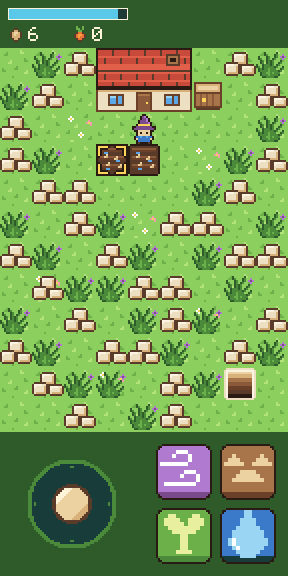
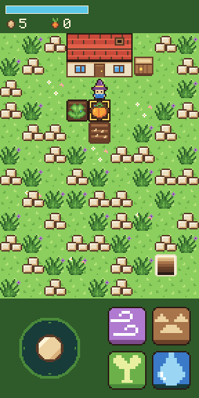
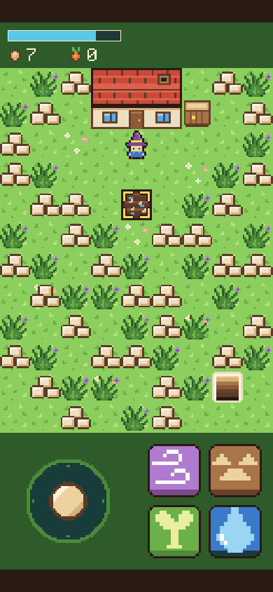

# Step 5: Water

**The ask:** [`asks/step-05.md`](../asks/step-05.md), written once and sent word for word to both builders on 11 November 2026: to Godot's at 1:16 pm Central and to Bevy's at 2:12 pm, each when its builder had finished step 4.

**Result: a tie at one ask each.** Both builds pass all 116 things the referee's check tries, and neither needed a second ask. The score after five steps is Godot 5 asks, Bevy 6.

## For the short

The numbers and the moments from this step that are worth telling. Everything here is from the log below.

- **The score:** a tie, one ask each. So far: Godot 5 asks, Bevy 6.
- **Bevy's game was done in 7 minutes. Its builder handed it back after 1 hour 54.** The water, the growing, the picking and the weeds were written and built by 7 minutes after the ask. The rest went on testing. Godot's builder handed back the same step in 30 minutes.
- **Why Bevy's tests were slow.** To check a crop that ripens in 40 seconds, both builders hold the page's clock and move it on by hand. In Bevy's build, each small step of a held clock ran the game about 30 times, and after a few sounds each step took 1 to 2 seconds of real time. Its builder spent 15 minutes finding that and settled for bigger steps. A 90-second test still took about 12 minutes.
- **By the time Bevy's step 5 came back, Godot's builder had finished steps 6 and 7 as well.** Separate machines mean neither waits for the other, so the gap shows as steps, not minutes.
- **Both builders read the weeds rule the same way.** The ask says weeds grow on the bare grass farthest from the mage, and does not say what breaks a tie. Both chose the tile highest up, then the one farthest left, without seeing each other.
- **Both made the growing keep to the clock, a different way each.** Godot's crop works out its stage every frame from how old it is, by the real clock. Bevy's counts from its watering on the game's own clock, and its weeds come every 45 seconds counted from the cover, so they never drift.
- **Code:** Godot is now 822 lines in 15 files, Bevy 1,869 in 16. That is 95 lines more for Godot this step and 207 for Bevy.
- **The download:** 39.9 MB and 14.4 MB from a plain host, or 10.5 MB and 4.6 MB the way a host that compresses sends them. Godot's grew by 2 KB this step, Bevy's by 44 KB, nearly all of it the two new sounds Bevy carries inside its one big file.
- **In the test browser at the playing size,** Godot draws 61 frames a second and Bevy 44. Draw's sound starts 16 to 20 thousandths of a second after the touch in Godot, and 131 to 138 in Bevy.
- **A slip owned up to.** Bevy's builder said in its step 4 report that it ran 80 new checks. It counted again and wrote, unasked, that it was 72.
- **Clips:** a film of each build doing the step is saved with the project's files (`clips/godot-step-05.mp4`, 70 seconds, and `clips/bevy-step-05.mp4`, 74 seconds).
- **Pictures:** four screenshots of each build are in [`step-05/`](step-05/).

| | Godot 4.7.2 | Bevy 0.20.1 |
| --- | --- | --- |
| Asks for this step | 1 | 1 |
| Asks so far | 5 | 6 |
| Builder's time, from the ask to its report | 30 min | 1 h 54 min, with the game itself done in 7 |
| What the build is now | 822 lines in 15 files (727 after step 4) | 1,869 lines in 16 files, plus a lock file (1,662 after step 4) |
| Download from a plain host | 39.9 MB in 7 files, 2 KB more than step 4 | 14.4 MB in 3 files, 44 KB more than step 4 |
| The same, with the big file gzipped | 10.5 MB | 4.6 MB |
| The game's own part of that | 70 KB | not separate |
| The builder's own checks before it reported | 312 (37 new, 275 from before) | 55 new, and every check from steps 1 to 4 |

The times are what the builders reported.

## What the ask pinned down

A fourth spell, Draw, with its own button. It costs 10 mana and waters a planted seed that has not been watered: the ground under it turns to wet soil. A watered crop grows by itself on its own time: a sprout from 10 seconds, grown from 25, ripe from 40. A seed never watered stays a seed. A touch on a ripe crop within 2 tiles picks it: the tile goes back to bare grass, the crop count goes up by one, and it costs no mana and gives no seed back. Every 45 seconds from the cover, weeds grow on the bare grass tile farthest from the mage, counted as tiles across plus tiles up or down. The 4 key casts Draw.

## The referee's check

[`tools/check-step-05.cjs`](../tools/check-step-05.cjs) tries 116 things in six views and films a seventh. It runs on the real clock: it waters two crops a few seconds apart and watches each stage come at its time, waits for the weeds at 45 and 135 seconds, and picks both crops. Before either build saw it, it was tried on a plain stand-in page written from the same ask. Copies of that page with one fault each have not been run on it yet. The step 3 and step 4 checks were also run on each step 5 build, at the playing size, to see that nothing old broke.

| Checked | Godot | Bevy |
| --- | --- | --- |
| The Draw button and the crop count are drawn where the ask says, at every size | yes | yes |
| Draw on a planted seed turns the ground wet, costs 10, and plays its sound | yes | yes |
| Draw on grass, dry soil, a watered crop, rubble, the house, the crate, the stairwell or no tile changes nothing and plays "no" | yes | yes |
| A watered crop is a seed until 10 seconds, a sprout until 25, grown until 40, then ripe | yes | yes |
| Each crop keeps its own time, and a seed never watered waits | yes | yes |
| The other spells on a growing or ripe crop change nothing and play "no" | yes | yes |
| A touch on a crop that is not ripe only aims, and a ripe crop 3 tiles away can't be picked | yes | yes |
| The step's own line: a touch on the ripe crop picks it, leaves bare ground, the count goes to 1 and the pick sound plays | yes | yes |
| Picking costs no mana and gives no seed back | yes | yes |
| The stick's thumb, or a touch from a button, slid onto a ripe crop does not pick it | yes | yes |
| Weeds at 45 seconds, and again at 135, on the bare grass tile farthest from the mage and no other | yes | yes |
| The Draw button goes dim under 10 mana, and a cast without the mana does nothing and makes no sound | yes | yes |
| Two thumbs, a held button, and the 4 key at PC size | yes | yes |
| The page did not scroll, zoom or select anything | yes | yes |
| Page errors | none | none |
| Things passed | 116 of 116 | 116 of 116 |
| The step 4 check on the step 5 build, at the playing size | 69 of 69 | 69 of 69 |
| The step 3 check on the step 5 build, at the playing size | 63 of 63 | 63 of 63 |
| How long after the touch Draw's sound starts, at the playing size | 16 to 20 ms | 131 to 138 ms |
| Frames a second in the test browser, at the playing size | 61 | 44 |

| | Godot | Bevy |
| --- | --- | --- |
| Two seeds watered |  |  |
| Weeds back, on the farthest bare grass |  |  |
| Ripe |  |  |
| On a phone's screen |  |  |

The numbers are in [`step-05/godot-check.json`](step-05/godot-check.json) and [`step-05/bevy-check.json`](step-05/bevy-check.json).

## Godot: what came back

No new script. The lot gained watering, picking, the growing and the weeds, and keeps its own clock for them. The mage gained its crops, and the aim hands a touch on a ripe crop to the lot to pick. The Draw button and the crop count reuse the button and count scripts from step 4.

Choices the builder made where the ask was open: the picked tile is plain grass. A tie for the weeds goes to the tile highest up, then the one farthest left. A crop's stage is worked out every frame from its age. The growing and the weeds go by the real clock, so they keep time even when the page draws very slowly and the engine stops counting a frame's full length, and a phone that stops drawing catches up at once when it comes back.

What went wrong on the way, by the builder's own report: nothing in the game. One old check once misread a single screenshot at a phone's real sharpness and passed on the next run.

What it could not check: a real phone.

## Bevy: what came back

One new source file, `crop.rs`, for growing, picking and the weeds. The count code from step 4 now draws any count from a short description, which covers seeds and crops. Draw is a fourth row in the spell table. The lot keeps each crop's watering time. Two more sounds go into the .wasm file.

Choices the builder made where the ask was open: the weeds' 45 seconds count from the frame the cover goes, each one a fixed 45 seconds after the last, so they never drift. A ripe crop and a button touched in the same frame are picked first, then cast. A tie for the weeds goes to the tile highest up, then the one farthest left. A picked tile is plain grass, even where it had flowers before.

What went wrong on the way, by the builder's own report: nothing in the game, which was written and built 7 minutes after the ask. Its held-clock tests were the slow part, as told above. One compile error in its count code needed one more line. Three mistakes in its own tests. When it ran the step 3 checks again, one of them touched a place it thought was off every button, which is now the Draw button. With a place still off every button, they passed.

What it could not check: a real phone, hearing the sounds, and the case where there is no bare grass left when weeds are due.

## Not checked

- Either build's step 5 on a real phone.
- What happens when weeds are due and there is no bare grass. Neither check reaches it.
