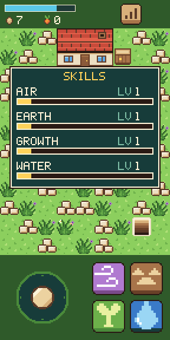
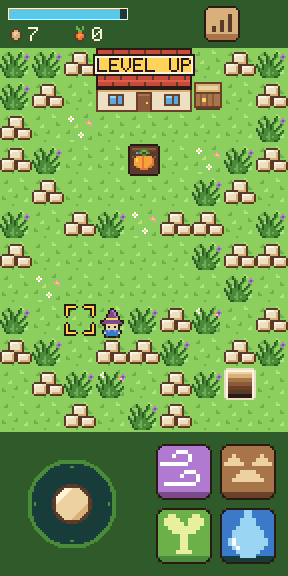
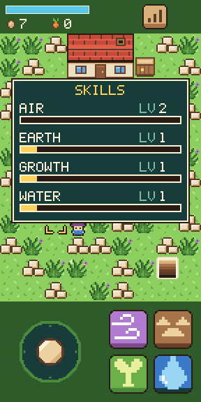
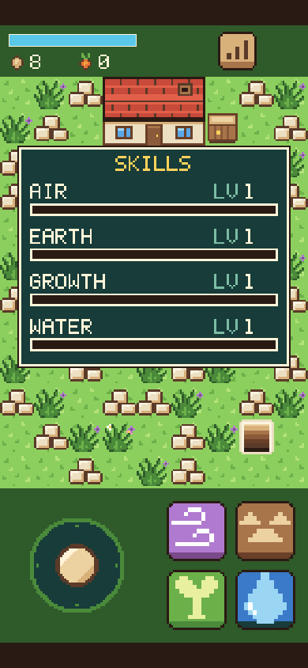
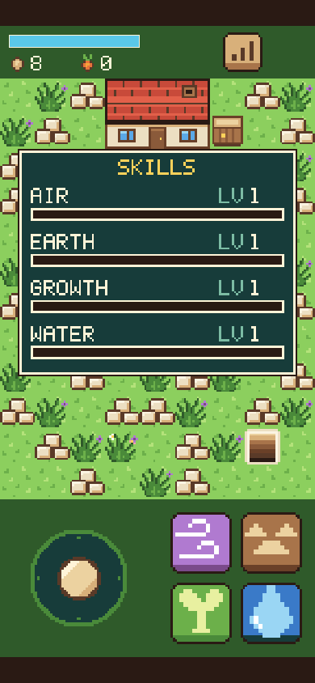

# Step 6: Skills

**The ask:** [`asks/step-06.md`](../asks/step-06.md), written once and sent word for word to both builders on 11 November 2026: to Godot's at 1:56 pm Central and to Bevy's at 4:12 pm, each when its builder had finished step 5. It came with new shared art: the skills button, the panel and the level-up pop.

**Result: a tie at one ask each.** Both builds pass all 89 things the referee's check tries, and neither needed a second ask. The score after six steps is Godot 6 asks, Bevy 7.

## For the short

The numbers and the moments from this step that are worth telling. Everything here is from the log below.

- **The score:** a tie, one ask each. So far: Godot 6 asks, Bevy 7.
- **The same split as step 5.** Godot's builder handed back in 40 minutes. Bevy's had its game built 10 minutes after the ask and handed back after 1 hour 44 minutes, the rest spent testing.
- **Bevy's builder found two faults no person would see.** Its pixel checks found a line one screen pixel wide at the edge of the seed picture on a sharp phone screen, and another under one of the panel's bars at PC size. Both came from an edge landing exactly on the middle of a screen pixel. It changed the game so that every piece of art is cut out as a picture of its own when the game starts. Godot's builder had nothing of the kind to fix.
- **Both builders chose the same rounding without seeing each other.** The ask says each level needs 12% more XP than the one before, to the nearest whole number. Both work out each level from the rounded one before, and both noticed, unasked, that rounding only at the end would first differ at level 10, needing 277 XP against 278.
- **And the same answer on the pop:** both keep the level-up pop's 1.5 seconds waiting while the panel is open.
- **Code:** Godot is now 1,003 lines in 18 files, Bevy 2,183 in 17. That is 181 lines more for Godot this step and 314 for Bevy.
- **The download:** 39.9 MB and 14.5 MB from a plain host, or 10.6 MB and 4.7 MB the way a host that compresses sends them. Godot's grew by 6 KB, Bevy's by 67 KB.
- **In the test browser at the playing size,** Godot draws 61 frames a second and Bevy 43. The level-up sound starts 17 thousandths of a second after the touch in Godot and 143 in Bevy.
- **Clips:** a film of each build doing the step is saved with the project's files (`clips/godot-step-06.mp4`, 35 seconds, and `clips/bevy-step-06.mp4`, 43 seconds).
- **Pictures:** four screenshots of each build are in [`step-06/`](step-06/).

| | Godot 4.7.2 | Bevy 0.20.1 |
| --- | --- | --- |
| Asks for this step | 1 | 1 |
| Asks so far | 6 | 7 |
| Builder's time, from the ask to its report | 40 min | 1 h 44 min, with the game first built in 10 |
| What the build is now | 1,003 lines in 18 files (822 after step 5) | 2,183 lines in 17 files, plus a lock file (1,869 after step 5) |
| Download from a plain host | 39.9 MB in 7 files, 6 KB more than step 5 | 14.5 MB in 3 files, 67 KB more than step 5 |
| The same, with the big file gzipped | 10.6 MB | 4.7 MB |
| The game's own part of that | 77 KB | not separate |
| The builder's own checks before it reported | 348 (36 new, 312 from before) | 60 new, and every check from steps 1 to 5 |

The times are what the builders reported.

## What the ask pinned down

Each spell trains a school: Gust trains Air, Break Ground Earth, Sprout Growth and Draw Water. A cast that changes something gives its school 10 XP. A "no" cast, a cast without the mana and picking give nothing. Level 2 needs 100 XP and each level after needs 12% more than the one before, to the nearest whole number. What is over is kept. A level-up plays its sound and shows a pop for 1.5 seconds. A button in the top strip opens a panel with each school's level and a bar. While it is open the whole game stands still, and the next touch, wherever it starts, only closes it. The K key opens and closes it.

## The referee's check

[`tools/check-step-06.cjs`](../tools/check-step-06.cjs) tries 89 things in six views and films a seventh. Before either build saw it, it was tried on a plain stand-in page written from the same ask. The checks for steps 3 to 5 were also run on each step 6 build, at the playing size, to see that nothing old broke.

| Checked | Godot | Bevy |
| --- | --- | --- |
| The skills button is in the top strip, and the panel is drawn where the ask says, at every size | yes | yes |
| All four schools start at level 1 with empty bars | yes | yes |
| Each cast that changed something gave its own school 10 XP, and casts that changed nothing gave none | yes | yes |
| While the panel is open, the mana, the crop's growing and the weeds' clock all stand still | yes | yes |
| A touch on the stick, a spell button or a tile only closes the panel | yes | yes |
| The step's own line: the tenth Gust takes Air to level 2, the pop shows and the level-up sound plays | yes | yes |
| The pop stays 1.5 seconds and goes | yes | yes |
| The panel shows Air at level 2 with an empty bar, and after three more Gusts 30 of 112 | yes | yes |
| The bars are drawn in their color, to the pixel | yes | yes |
| Picking gives no XP | yes | yes |
| The K key and the mouse open and close the panel at PC size | yes | yes |
| The page did not scroll, zoom or select anything | yes | yes |
| Page errors | none | none |
| Things passed | 89 of 89 | 89 of 89 |
| The step 5 check on the step 6 build, at the playing size | 56 of 56 | 56 of 56 |
| The step 4 check on the step 6 build, at the playing size | 69 of 69 | 69 of 69 |
| The step 3 check on the step 6 build, at the playing size | 63 of 63 | 63 of 63 |
| How long after the touch the level-up sound starts, at the playing size | 17 ms | 143 ms |
| Frames a second in the test browser, at the playing size | 61 | 43 |

| | Godot | Bevy |
| --- | --- | --- |
| One cast of each spell: 10 XP each |  |  |
| The tenth Gust: level up |  |  |
| The panel: Air at level 2 |  |  |
| On a phone's screen |  |  |

The numbers are in [`step-06/godot-check.json`](step-06/godot-check.json) and [`step-06/bevy-check.json`](step-06/bevy-check.json).

## Godot: what came back

Three new scripts: `skills.gd` for the schools and the panel, `pop.gd` for the pop, and `piece.gd` for a fixed piece of art, used for the skills button. Each spell names its school and trains it. While the panel is open the game is paused with the engine's own pause, and only the panel runs.

Choices the builder made where the ask was open: each level's need is 12% more than the rounded one before. A sound already playing finishes while the panel is open. A stick held when the panel opens stays held, and walks on after if the thumb is still down. A second level-up while the pop shows starts its 1.5 seconds over.

What went wrong on the way, by the builder's own report: nothing in the game. Two of its old checks now also heard the level-up sound and were told to leave it out. When its tests clicked a tile and pressed a key in the same frame, the engine's web build lost their order. A phone has no mouse or keys, so its tests now wait two frames between them.

What it could not check: a real phone, and levels above 2.

## Bevy: what came back

One new source file, `skills.rs`, for the schools, XP, levels, the pop and the panel. Each spell gives its school XP after a cast that changed something. The stick, walking, aiming, casting and picking now wait while the panel is open. Every piece of art is now cut out as a picture of its own when the game starts.

Choices the builder made where the ask was open: each level's need is worked out from the rounded one before. The touch that closes the panel is used up, so the same finger slid onto the stick does not walk. A touch on the skills button while the panel is open only closes it. The pop is drawn under the panel, and the two never overlap.

What went wrong on the way, by the builder's own report: the two one-pixel faults told above, found by its own pixel checks and fixed in the game. In the old checks, three misses came from the new level-up sound and four from timing while two or three test browsers ran at once. Run on their own, those passed.

What it could not check: a real phone, hearing the sounds, and a school reaching level 3.

## Not checked

- Either build's step 6 on a real phone.
- Any school above level 2 in either build.
