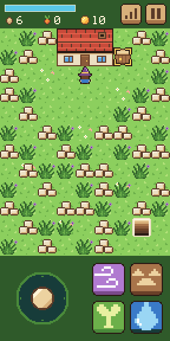
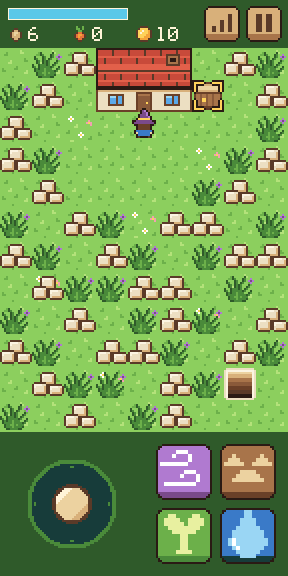
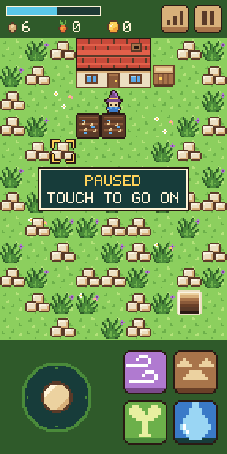
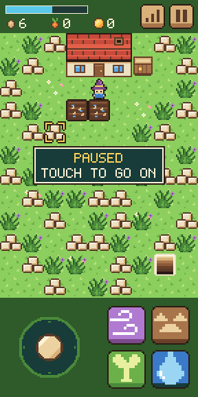
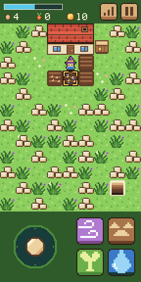
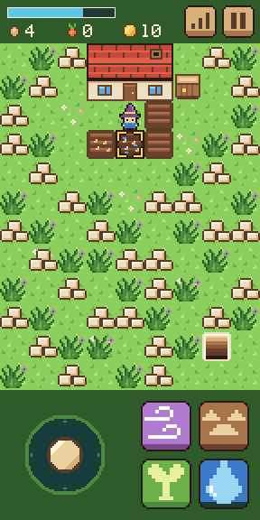

# Step 7: Sell, save, and a phone call

**The ask:** [`asks/step-07.md`](../asks/step-07.md), written once and sent word for word to both builders on 11 November 2026: to Godot's at 2:48 pm Central and to Bevy's at 6:05 pm, each when its builder had finished step 6. Nothing in the shared art changed for it.

**Result: a tie at one ask each.** Both builds pass all 120 things the referee's check tries, and neither needed a second ask. A real phone played Godot's build at this step, and the word back was that it is good. The score after seven steps is Godot 7 asks, Bevy 8. The outside review and bot playtest that the rules set after step 7 is still to come, and any fix it forces counts as an ask for this step.

## For the short

The numbers and the moments from this step that are worth telling. Everything here is from the log below.

- **The score:** a tie, one ask each. So far: Godot 7 asks, Bevy 8.
- **The phone call.** This is the step where a call comes in, the player switches apps, and the farm has to be there when they come back. Both builds pause by themselves, save at that moment, and show the pause panel on return.
- **Neither builder could make its test browser really leave the page.** Both tried and both say so. The test browser always says the page is showing, even behind another tab or with the window shrunk away. Bevy's builder tried four ways. So both told the page by hand that it was hidden, the way a phone's browser does. Godot's also froze the page for 1 to 5 seconds to play out a phone putting it to sleep.
- **The same split as steps 5 and 6.** Godot's builder handed back in 36 minutes. Bevy's had its game built 16 minutes after the ask and handed back after 1 hour 42 minutes. 55 of those minutes went on running its checks from steps 1 to 6 again.
- **Both found, unasked, what a save from a later step needs.** The ask says a game saved now must still open after later steps. Both save in a plain text form where anything a save lacks takes its starting value and anything it doesn't know is skipped, and both tested a save with an extra field in it. Both start a fresh game, with no error, from a save that can't be read.
- **Godot's builder thought about the phone that never wakes the page again.** It saves the moment the page is hidden, because on a phone that may be the last chance. It also notes that a page swiped away in the phone's app switcher may never get to save on closing, so the save from leaving is the one that counts.
- **Code:** Godot is now 1,259 lines in 20 files, Bevy 2,694 in 20. That is 256 lines more for Godot this step and 511 for Bevy.
- **The download:** 39.9 MB and 14.6 MB from a plain host, or 10.6 MB and 4.7 MB the way a host that compresses sends them. Godot's grew by 7 KB, Bevy's by 65 KB.
- **In the test browser at the playing size,** Godot draws 61 frames a second and Bevy 44.
- **Clips:** a film of each build doing the step is saved with the project's files (`clips/godot-step-07.mp4`, 70 seconds, and `clips/bevy-step-07.mp4`, 73 seconds).
- **Pictures:** three screenshots of each build are in [`step-07/`](step-07/).

| | Godot 4.7.2 | Bevy 0.20.1 |
| --- | --- | --- |
| Asks for this step | 1 | 1 |
| Asks so far | 7 | 8 |
| Builder's time, from the ask to its report | 36 min | 1 h 42 min, with the game first built in 16 |
| What the build is now | 1,259 lines in 20 files (1,003 after step 6) | 2,694 lines in 20 files, plus a lock file (2,183 after step 6) |
| Download from a plain host | 39.9 MB in 7 files, 7 KB more than step 6 | 14.6 MB in 3 files, 65 KB more than step 6 |
| The same, with the big file gzipped | 10.6 MB | 4.7 MB |
| The game's own part of that | 83 KB | not separate |
| The builder's own checks before it reported | 388 (40 new, 348 from before) | 76 new, and every check from steps 1 to 6 |
| Played on a real phone | yes, and it is good | not yet |

The times are what the builders reported.

## What the ask pinned down

The mage has coins, none at the start, and the count shows in the top strip. A touch on the crate within 2 tiles sells every crop for 5 coins each and plays `sell.wav`. With no crops it plays "no", and from farther away it does nothing. A pause button in the top strip pauses the game: a panel shows, everything stands still as under the skills panel, and the next touch only ends the pause. When the page is hidden, by switching apps or tabs or the screen going off, the game pauses by itself, and the pause panel is there on return, in place of the skills panel if that was open. The game saves itself in the browser every 30 seconds and whenever the page is hidden or closed: every tile, how far each crop has grown, the mana, seeds, crops, coins, each school's level and XP, and the weeds' clock. Opened again, after the cover the farm is as it was saved, with the mage on its starting tile facing down, and no time has passed while it was closed. A game saved now must open after later steps. The P key pauses.

## The referee's check

[`tools/check-step-07.cjs`](../tools/check-step-07.cjs) tries 120 things in six views and films a seventh. It leaves the page the same way both builders did, by telling it that it is hidden, and it closes the page for real and opens it again in the same browser. Before either build saw it, it was tried on a plain stand-in page written from the same ask. The checks for steps 3 to 6 were also run on each step 7 build, at the playing size, to see that nothing old broke.

| Checked | Godot | Bevy |
| --- | --- | --- |
| The coin count and the pause button are drawn where the ask says, at every size | yes | yes |
| With no crops, a touch on the crate plays "no" and changes nothing | yes | yes |
| A sale: 5 coins a crop, the crops to none, `sell.wav`, no mana spent, the touch aims at the crate | yes | yes |
| A touch on the crate from farther away does nothing | yes | yes |
| Selling gives no XP | yes | yes |
| The pause button pauses: the panel shows and nothing changes while it is up | yes | yes |
| A touch on a button, the stick or a tile only ends the pause | yes | yes |
| The page hidden while playing: paused and saved, and still paused on return | yes | yes |
| The page hidden with the skills panel open: the pause panel shows instead | yes | yes |
| After coming back, the game goes on and its sounds still play | yes | yes |
| Hidden under the cover: nothing to pause | yes | yes |
| A save 30 seconds after the cover | yes | yes |
| The step's own line: the page closed and opened again shows the same farm, every school as it was, the mage at the start facing down, not paused | yes | yes |
| No time passed while the page was closed: the crop sprouts 10 seconds of play after it was watered | yes | yes |
| The P key and the mouse at PC size | yes | yes |
| The page did not scroll, zoom or select anything | yes | yes |
| Page errors | none | none |
| Things passed | 120 of 120 | 120 of 120 |
| The step 6 check on the step 7 build, at the playing size | 32 of 32 | 32 of 32 |
| The step 5 check on the step 7 build, at the playing size | 56 of 56 | 56 of 56 |
| The step 4 check on the step 7 build, at the playing size | 69 of 69 | 69 of 69 |
| The step 3 check on the step 7 build, at the playing size | 63 of 63 | 63 of 63 |
| Frames a second in the test browser, at the playing size | 61 | 44 |

| | Godot | Bevy |
| --- | --- | --- |
| A harvest sold |  |  |
| Paused |  |  |
| Closed and opened again: the same farm |  |  |

The numbers are in [`step-07/godot-check.json`](step-07/godot-check.json) and [`step-07/bevy-check.json`](step-07/bevy-check.json).

## Godot: what came back

Two new scripts: `pause.gd` for the pause button, the panel and leaving the page, and `save.gd` for saving and loading. The lot can now sell, and can list and put back every tile. The skills panel can give way to the pause panel.

Choices the builder made where the ask was open: the save is kept under the name `godot-farm-save`. It saves the moment the page is hidden. The 30 seconds count only while the game runs, not under the cover or while paused. The aimed tile, the pop and the stick are not saved. The P key with the skills panel open swaps it for the pause panel.

What went wrong on the way, by the builder's own report: a save that couldn't be read printed an engine error on the page. It switched to a reader that fails quietly, and the game starts fresh. The rest were mistakes in its own tests.

What it could not check: a real switch to another app, and a page killed from a phone's app switcher, which may skip the save on closing.

## Bevy: what came back

Three new source files: `panel.rs` for what the skills panel and the pause panel share, moved out of `skills.rs`; `pause.rs` for the pause button and panel and pausing when the page is hidden; and `save.rs` for saving and putting a saved game back. Selling went into `crop.rs` and the coins into `counts.rs`. To reach the browser's storage and hear when the page is hidden, it names two pieces that Bevy already brings in.

Choices the builder made where the ask was open: the save is kept under the name `farm-bevy-save`. The 30 seconds count real time from when the cover goes. Nothing is saved while the cover is up, so a page opened and closed on the cover leaves the old save as it was. A touch on the pause button while the skills panel is open only closes the skills panel. A crop picked and the crate touched in the same frame are picked first, so that crop is sold too.

What went wrong on the way, by the builder's own report: nothing in the game, which compiled the first time. Two mistakes in its own tests. Running its step 3 and step 4 checks again, five things missed: three from the level-up sound added in step 6, one because a touch on the crate now also tries to sell and plays "no", and one walk that stopped a few pixels short while another test browser ran beside it, and passed on its own.

What it could not check: a real phone, hearing the sounds, a real switch to another app, and a browser that won't keep the save, as in private browsing on some phones.

## Not checked

- Bevy's step 7 on a real phone.
- A real switch to another app or a real screen going off, in either build, beyond the one phone try of Godot's.
- A browser that refuses to keep the save.
