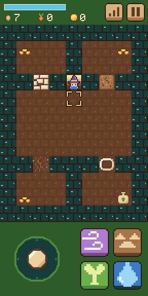
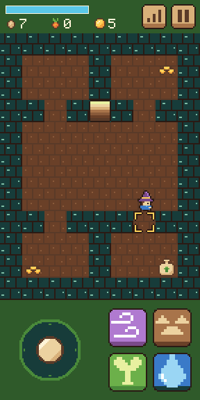
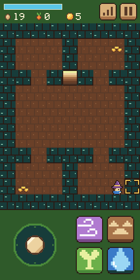

# Step 8: Down the stairs

**The ask:** [`asks/step-08.md`](../asks/step-08.md), written once and sent word for word to both builders: to Godot's at 3:39 pm Central on 11 November 2026, and to Bevy's at 8:02 pm, each when its builder had finished step 7. It came with new shared art: the dungeon floor's map and its pieces.

**Result: a tie at one ask each.** Both builds pass all 122 things the referee's check tries, and neither needed a second ask. Each build made the check miss on its first run, and each time the check was at fault, not the build. The score after eight steps is level: Godot 9 asks, Bevy 9.

## For the short

The numbers and the moments from this step that are worth telling. Everything here is from the log below.

- **The score:** a tie, one ask each. So far: Godot 9 asks, Bevy 9.
- **Godot's builder handed back in 71 minutes, Bevy's in 2 hours 41.** About 80 of Bevy's minutes went on running its checks from steps 1 to 7 again.
- **The fade showed how differently the two engines mix a color.** The ask says the place darkens evenly to a dark brown over a quarter of a second. Godot's fade is even in the color numbers. Bevy mixes colors as light, so a quarter of the way in, its picture is halfway to the dark in light but only about a third of the way in the numbers. Both reach the dark brown at the same moment. Bevy's builder told this unasked, as a choice the ask left open. The referee's check had been judging in the numbers, and now judges in light, which takes both.
- **Godot's builder slowed the game down 16 times to watch the fade.** It took 243 screenshots of one trip down and measured each half at a quarter of a second, to within a frame.
- **Each builder's own checks found the stairwell in its old tests.** From this step a walk over the stairwell takes the mage down, and both builders' step 1 and 2 checks had walked across it to see that nothing happens. The referee's step 3 check did the same, on Godot's build first.
- **Bevy's checks found one fault in its own game before it handed back:** if the page was hidden in the middle of a trip, the aim mark was left behind on the other place. It fixed that. Godot's found nothing in its game.
- **The seed count reached two digits for the first time.** The cache's 12 seeds took both counts to 20, and both drew the two digits right. That closes something step 4 could not check.
- **Code:** Godot is now 1,499 lines in 23 files, Bevy 3,063 in 21. That is 240 lines more for Godot this step and 369 for Bevy.
- **The download:** 39.9 MB and 14.6 MB from a plain host, or 10.6 MB and 4.7 MB the way a host that compresses sends them. Godot's grew by 6 KB, Bevy's by 51 KB.
- **In the test browser at the playing size,** Godot draws 61 frames a second and Bevy 53.
- **Clips:** a film of each build doing the step is saved with the project's files (`clips/godot-step-08.mp4`, 54 seconds, and `clips/bevy-step-08.mp4`, 62 seconds).
- **Pictures:** three screenshots of each build are in [`step-08/`](step-08/).

| | Godot 4.7.2 | Bevy 0.20.1 |
| --- | --- | --- |
| Asks for this step | 1 | 1 |
| Asks so far | 9 | 9 |
| Builder's time, from the ask to its report | 71 min | 2 h 41 min, about 80 min of it re-running the older checks |
| What the build is now | 1,499 lines in 23 files (1,259 after step 7) | 3,063 lines in 21 files, plus a lock file (2,694 after step 7) |
| Download from a plain host | 39.9 MB in 7 files, 6 KB more than step 7 | 14.6 MB in 3 files, 51 KB more than step 7 |
| The same, with the big file gzipped | 10.6 MB | 4.7 MB |
| The game's own part of that | 89 KB | not separate |
| The builder's own checks before it reported | 492 (104 new, 388 from before) | 141 new, and every check from steps 1 to 7 |

The times are what the builders reported.

## What the ask pinned down

The lot has a stairwell. When the mage steps onto it, it goes down to one dungeon floor, drawn from the shared map in the same place as the lot, and stands on the stairs up. Stepping onto the stairs up brings it back to the stairwell. Arriving on stairs doesn't use them. A trip takes half a second: the place darkens evenly to `#2a1a14` over a quarter of a second, then the other place comes out of the dark, and nothing moves or changes meanwhile. Walls and shut gates stop the mage. Each of four gates opens to one spell only: rubble to Gust, packed dirt to Break Ground, a dead vine to Sprout (with no seed needed), a dry basin to Draw. The right spell costs its mana, plays its sound and gives 10 XP; any other cast below plays "no". Stepping on coins gives 5 coins and `sell.wav`; the seed cache gives 12 seeds and `pick.wav`. Every trip down starts fresh. The lot stands still while the mage is below. Panels, the pause and leaving the page work below. The dungeon is never saved.

## The referee's check

[`tools/check-step-08.cjs`](../tools/check-step-08.cjs) tries 122 things in five views and films a sixth. It walks the whole floor: every gate with the three wrong spells and then the right one, the coins, the cache, back up, down again, and the page closed while below. Before either build saw it, it was tried on a plain stand-in page written from the same ask. The checks for steps 3 to 7 were also run on each step 8 build, at the playing size.

| Checked | Godot | Bevy |
| --- | --- | --- |
| Walking onto the stairwell takes the mage down, and the dungeon is as the shared map has it, to the pixel | yes | yes |
| The place fades to the dark color and back | yes | yes |
| Arriving on the stairs does not send the mage back | yes | yes |
| Walls and shut gates stop the mage | yes | yes |
| Each gate: the three wrong spells play "no" and cost nothing, the right one opens it with its sound and its cost | yes | yes |
| Sprout opens the dead vine with no seed used | yes | yes |
| Opening a gate gives its school 10 XP | yes | yes |
| The coins: 5 more and `sell.wav`. The cache: 12 more seeds, `pick.wav`, and a two-digit count drawn right | yes | yes |
| The mana comes back below as always | yes | yes |
| The step's own line: back on the lot with the seeds and coins, and the lot stood still while the mage was below | yes | yes |
| Every trip down starts fresh | yes | yes |
| Closed while below and opened again: on the lot, at the start, with the seeds and coins kept | yes | yes |
| The pause below, and the keys and the mouse at PC size | yes | yes |
| Page errors | none | none |
| Things passed | 122 of 122 | 122 of 122 |
| The step 7 check on the step 8 build, at the playing size | 49 of 49 | 49 of 49 |
| The step 6 check on the step 8 build, at the playing size | 32 of 32 | 32 of 32 |
| The step 5 check on the step 8 build, at the playing size | 56 of 56 | 56 of 56 |
| The step 4 check on the step 8 build, at the playing size | 69 of 69 | 69 of 69 |
| The step 3 check on the step 8 build, at the playing size | 63 of 63 | 63 of 63 |
| Frames a second in the test browser, at the playing size | 61 | 53 |

| | Godot | Bevy |
| --- | --- | --- |
| Down the stairs |  |  |
| The basin gate opened with Draw |  |  |
| The cache taken: 20 seeds |  |  |

The numbers are in [`step-08/godot-check.json`](step-08/godot-check.json) and [`step-08/bevy-check.json`](step-08/bevy-check.json).

## The referee's own misses

None of these cost a build an ask. Each correction asks less than the line before it, so a build that passed the old line passes the new one.

- **The step 3 check walked the mage down the stairs.** Its walk for measuring the mage's speed crosses the stairwell's row. On Godot's step 8 build the mage went down, as step 8 asks, and two of the step 3 check's things missed. The walk now goes along a row well above the stairwell. Run again, all 63 passed. Bevy's build was only ever checked with the new walk.
- **A cast from a full mana bar.** The check reckoned the most mana a gate's cast could leave by capping the bar at 100 before taking the cost off. Mana spent from a full bar starts coming back at once, so a reading a little over that is right. This missed once on Godot's build and once on Bevy's. The reckoning now takes the cost off first. A second line, on mana coming back below, missed on Bevy's build when its reckoning reached the top of the bar, where the bar simply stays full. It now allows for that.
- **The fade, judged in color numbers.** On its first run on Bevy's build the check saw 11 screenshots across the trip down and wanted one at least 60% of the way to the dark color, in color numbers. The darkest was 59% of the way. Bevy mixes the dark in as light, which is lighter in the numbers half way through, and the ask says "evenly" without saying which. The check now judges the darkest screenshot in light, which takes both ways of mixing. Run again, it passed.
- After those corrections the play view was run again on each build. The results above take the play view from that run and the other views from the first.

## Godot: what came back

Three new scripts: `place.gd`, what both places share (the layers, what blocks, the tiles, the stairs, and the four spells); `dungeon.gd` for the dungeon; and `places.gd` for which place shows, the trips and the fade. The lot now builds on the shared place.

Choices the builder made where the ask was open: only the place darkens, so the level-up pop and the panels stay above the dark, and the pop's 1.5 seconds keep counting. A pause or the skills panel during a trip holds it, and it goes on after. The lot's clock stops when a trip down begins and starts again when a trip up ends.

What went wrong on the way, by the builder's own report: nothing in the game. Four of its older checks walked over the stairwell and were changed to go round it or expect the trip. Stopping the page's clock did not give exact frame times, because the engine smooths them, so it measured the fade in slow motion instead.

What it could not check: a real phone, and the fade at a real phone's frame rate.

## Bevy: what came back

One new source file, `dungeon.rs`, for which place shows, the stairs, the trip and its fade, and taking the coins and the cache. Each place now hangs all its pictures from one root that shows or hides the whole place. A new lot clock runs only while the mage is on the lot.

Choices the builder made where the ask was open: the fade is even in light, as told above. The trip runs on the real clock, so it ends on time even if the page is hidden half way, while the game's own clock stands still for it. The dungeon is built fresh at the moment the places swap on each trip down.

What went wrong on the way, by the builder's own report: the one fault its checks found, the aim mark left behind when the page was hidden during a trip, which it fixed. Two compile errors, each fixed at once, one of them a name Bevy 0.20 changed. Its own test rig slowed to a stall with the page's clock held, and two long checks stalled until it found why.

What it could not check: a real phone, hearing the sounds, a real switch to another app, and the fade at a phone's own frame rate.

## Not checked

- Either build's step 8 on a real phone.
- The fade at a real phone's frame rate in either build.
