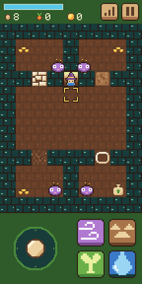
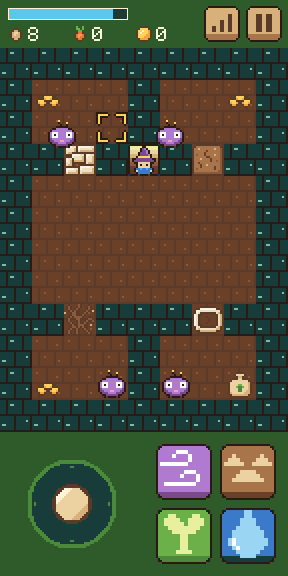
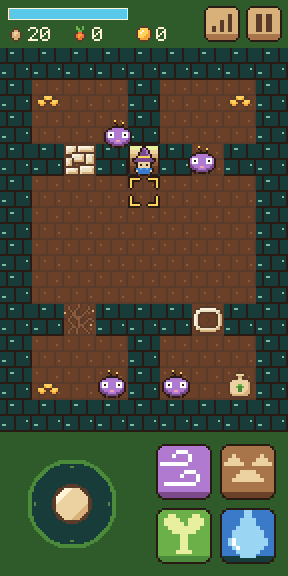

# Step 9: Something lives down here

**The ask:** [`asks/step-09.md`](../asks/step-09.md), written once and sent word for word to both builders: to Godot's at 5:11 pm Central on 11 November 2026, and to Bevy's at 11:05 pm, each when its builder had finished step 8. It came with new shared art: the creature, and the creatures' starting tiles in the dungeon's map.

**Result: a tie at one ask each.** Both builds pass all 77 things the referee's check tries, and neither needed a second ask. The score after nine steps is level: Godot 10 asks, Bevy 10.

## For the short

The numbers and the moments from this step that are worth telling. Everything here is from the log below.

- **The score:** a tie, one ask each. So far: Godot 10 asks, Bevy 10.
- **The first thing in either game that moves by itself and comes for you.** Four creatures walk at the mage when it is within 4 tiles. Gust throws one back, Draw slows it, three hits drive it off, and a touch costs half the mana and sends the mage back to the stairs.
- **The two builders took almost the same time, for the first time since step 2.** Godot's took 1 hour 59 minutes, its longest since step 3, and Bevy's 2 hours 1 minute. Bevy's game was built 9 minutes after the ask, and the rest went on testing.
- **Bevy's builder wrote a model of the rules before it tested anything.** It moves the mage and each creature frame by frame and says where everything should be. It planned its test walks on the model first, found that two creatures never shared a tile on the walk it had in mind, and changed the walk until the model showed the moment it needed. Then it cast in exactly that frame on the page.
- **Each builder's checks found one small thing in its own game, and each was about a single frame.** Godot's: in the frame where a creature's slow 2 seconds ran out, the whole frame was walked at one speed, which put the slow a few pixels off. Bevy's: in the frame a panel opened, a creature could take one more step. Bevy's engine was free to run the creatures before or after the touch that opened the panel, and it did one for each panel. Both fixed theirs before handing back.
- **Both found, unasked, what the map makes happen.** Each creature starts shut in behind a gate, so each gate also lets one creature out. And Godot's builder noted that a creature can never reach a mage standing on the stairs up.
- **Code:** Godot is now 1,699 lines in 25 files, Bevy 3,362 in 22. That is 200 lines more for Godot this step and 299 for Bevy.
- **The download:** 39.9 MB and 14.6 MB from a plain host, or 10.6 MB and 4.7 MB the way a host that compresses sends them. Godot's grew by 5 KB, Bevy's by 23 KB.
- **In the test browser at the playing size,** Godot draws 59 frames a second and Bevy 37.
- **Clips:** a film of each build doing the step is saved with the project's files (`clips/godot-step-09.mp4`, 36 seconds, and `clips/bevy-step-09.mp4`, 39 seconds).
- **Pictures:** three screenshots of each build are in [`step-09/`](step-09/).

| | Godot 4.7.2 | Bevy 0.20.1 |
| --- | --- | --- |
| Asks for this step | 1 | 1 |
| Asks so far | 10 | 10 |
| Builder's time, from the ask to its report | 1 h 59 min | 2 h 1 min, with the game first built in 9 |
| What the build is now | 1,699 lines in 25 files (1,499 after step 8) | 3,362 lines in 22 files, plus a lock file (3,063 after step 8) |
| Download from a plain host | 39.9 MB in 7 files, 5 KB more than step 8 | 14.6 MB in 3 files, 23 KB more than step 8 |
| The same, with the big file gzipped | 10.6 MB | 4.7 MB |
| The game's own part of that | 94 KB | not separate |
| The builder's own checks before it reported | 569 (77 new, 492 from before) | 139 new, and every check from steps 1 to 8 |

The times are what the builders reported.

## What the ask pinned down

Four creatures stand on their starting tiles in the dungeon, with 3 nerve each. While the mage is no more than 4 tiles across and 4 up or down, a creature walks straight at it at 57.6 pixels a second, sliding along walls, gates and the stairs up. Gust on a creature's tile throws it 64 pixels away from the mage, stopping short at what it can't cross. Draw slows it to half speed for 2 seconds. Each costs a nerve, and with none left the creature is gone until the next trip down. Break Ground and Sprout on a creature play "no". Two creatures on one tile are both hit for one cost. A touch halves the mana, puts the mage on the stairs up facing down, still below, plays "no", and sends the creatures home with the nerve they have left. Creatures stand still while the game does.

## The referee's check

[`tools/check-step-09.cjs`](../tools/check-step-09.cjs) tries 77 things in six views and films a seventh. Before either build saw it, it was tried on a plain stand-in page written from the same ask. The checks for steps 3 to 7 were also run on each step 9 build, at the playing size. The step 8 check walks the dungeon as it was before the creatures, so it is not run on later builds; the step 9 check walks the gates and the cache again with the creatures there.

| Checked | Godot | Bevy |
| --- | --- | --- |
| No creature on the lot, four on the dungeon floor, to the pixel | yes | yes |
| A creature within 4 tiles walks at the mage, slides along the wall and stops in the corner nearest it | yes | yes |
| A creature farther away stands still, and none comes onto the stairs | yes | yes |
| Break Ground and Sprout on a creature: the soft no, nothing spent | yes | yes |
| Draw: 10 mana, its sound, the creature not moved, half speed, and its own speed again 2 seconds later | yes | yes |
| Gust: 8 mana, its sound, thrown 64 pixels away from the mage | yes | yes |
| The third hit drives a creature off, and three Gusts through a wall drive off the one behind the basin | yes | yes |
| Every hit gives its school 10 XP | yes | yes |
| The gates and the cache still work with the creatures there | yes | yes |
| Every trip down brings all four back, and none comes up the stairs | yes | yes |
| The creatures stand still while paused | yes | yes |
| The step's own line: a creature touches the mage, which is put on the stairs facing down with half its mana, the soft no plays and the creature goes home | yes | yes |
| Page errors | none | none |
| Things passed | 77 of 77 | 77 of 77 |
| The step 7 check on the step 9 build, at the playing size | 49 of 49 | 49 of 49 |
| The step 6 check on the step 9 build, at the playing size | 32 of 32 | 32 of 32 |
| The step 5 check on the step 9 build, at the playing size | 56 of 56 | 56 of 56 |
| The step 4 check on the step 9 build, at the playing size | 69 of 69 | 69 of 69 |
| The step 3 check on the step 9 build, at the playing size | 63 of 63 | 63 of 63 |
| Frames a second in the test browser, at the playing size | 59 | 37 |

| | Godot | Bevy |
| --- | --- | --- |
| The creatures come |  |  |
| Gust on a creature |  |  |
| After a touch: on the stairs, half the mana |  |  |

The numbers are in [`step-09/godot-check.json`](step-09/godot-check.json) and [`step-09/bevy-check.json`](step-09/bevy-check.json).

## Godot: what came back

Two new scripts: `creature.gd` for one creature (where it starts, its nerve, its slow seconds, its tile and box) and `creatures.gd` for the four, their walking, Gust, Draw and a touch. The slide along walls is now shared, so the mage and the creatures use the same one.

Choices the builder made where the ask was open: the slow seconds run whether the creature walks or stands, and a second Draw starts them again. A Gust that takes a creature to no nerve drives it off at once, without throwing it first. On the mage's own tile a Gust throws the way the mage faces. A touch is checked once a frame, after every creature has moved, and several at once count as one. Creatures walk across first, then up or down, the way the mage slides.

What went wrong on the way, by the builder's own report: the one frame of the slow that was walked at the wrong speed, told above, fixed. Two of its step 8 checks walked into creatures that now come out of the opened gates, and were changed to drive the creatures off first. The rest was its test rig: finding the creatures made each picture read slower, and two checks measured too tightly.

What it could not check: a real phone, and real leaving and closing.

## Bevy: what came back

One new source file for the creatures. The mage's box sliding is now one function the creatures use too, and the mage's walk, with the creatures' after it, now runs after the presses that open a panel.

Choices the builder made where the ask was open: each frame the mage walks first, then each creature takes one step toward where the mage is now. A touch means the boxes overlap by more than nothing, checked once a frame. A Gust throw moves the creature a pixel at a time, so it never jumps a wall. A second Draw starts the 2 seconds again, and a touch keeps a creature's slow. All four creatures are drawn at one depth, so where two overlap either may be on top.

What went wrong on the way, by the builder's own report: the panel frame told above, found by its checks and fixed. One compile error, fixed at once. One of its own checks was written too tight and was fixed in the check. Its first plans for the test walks failed on its model before anything ran on the page.

What it could not check: a real phone, hearing the sounds, a real switch to another app, and every possible walk.

## Not checked

- Either build's step 9 on a real phone.
- Many creatures at once. The ask has four, and the series plan's question of what happens to each build with a lot of them is not reached.
