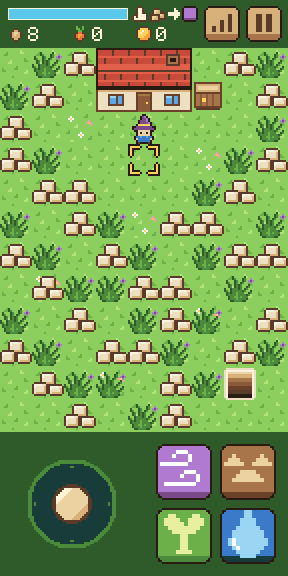
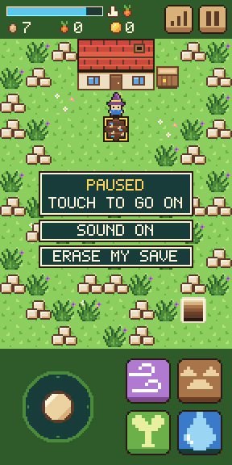
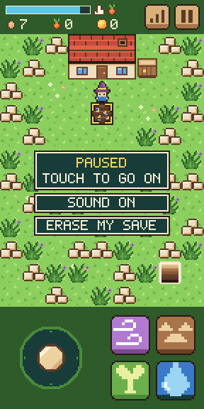
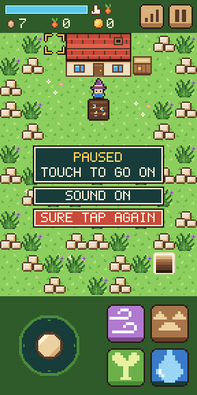
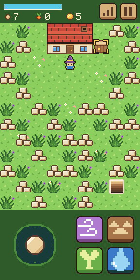

# Step 10: The prototype

**The ask:** [`asks/step-10.md`](../asks/step-10.md), written once and sent word for word to both builders: to Godot's at 7:25 pm Central on 11 November 2026, and to Bevy's at 1:23 am on 12 November, each when its builder had finished step 9. It came with new shared art: the six hint pieces and the two settings.

**Result: a tie at one ask each, and a tie for the whole run.** Both builds pass all 94 things the referee's check tries, and every older check. The outside review and bot playtest that the rules set after step 10 played both builds through and found nothing to fix in either. The score at the prototype is level: **Godot 11 asks, Bevy 11.**

## For the short

The numbers and the moments from this step, and from the whole run, that are worth telling. Everything here is from this log and the nine before it.

- **The final score:** Godot 11 asks, Bevy 11. Godot took step 1, when Bevy's farm showed none of its art on a real phone. Bevy took step 7, when an outside reviewer found Godot's mouse did nothing on a touchscreen laptop. Every other step was one ask each.
- **The prototype in both:** a new player follows six hints on the lot (clear a tile, break the ground, plant, water, pick, sell), goes down the stairs, drives off the creatures and takes the seed cache. Paused, there is a sound setting and a way to erase the saved game.
- **Bevy's game crashed while it was being built, and its builder's first checks caught it.** The hint piece was taken away and drawn again late in each frame. When two of the six things were done in two frames in a row, the piece was taken away while the engine was still finishing it, and the game stopped. The builder made one hint piece that is changed in place, earlier in the frame. Its checks then found the seed number missing for one frame after a Sprout, from the same cause, which may have been there before; no earlier check saw it. That is fixed too.
- **Two ways to start over.** The ask says erasing starts the game over as new, from the cover. Godot's build loads its own scene again inside the page, with no loading. Bevy's opens the page again, which gives exactly the first visit, with a moment of dark while it loads.
- **The last step took Godot's builder 68 minutes and Bevy's 3 hours 4.** Bevy's game was first built 17 minutes after the ask. Almost an hour and a half went on running the older steps' checks again.
- **Both builders' bots played the prototype by touch alone, following the hints, from the cover to the seed cache.** Godot's took about 106 seconds. Bevy's builder also ran the same walk where every pixel is checked after every step: it passed 19 of 21, with two creatures one frame behind its own model just after the trip down. It said it thinks its model is off there, and that it could not prove it.
- **The whole run, in time:** Godot's builder spent about 11 hours on the ten steps and its one fix-up, and Bevy's about 19 hours on the ten steps and its one fix-up. Bevy's game was often built within minutes of the ask, and its builder spent most of its hours testing.
- **The whole run, in code:** Godot ends at 1,850 lines in 26 files, Bevy at 3,691 in 23. Bevy needed about twice the lines for the same game at every step.
- **The whole run, in download:** Godot's is 39.9 MB from a plain host, nearly all of it the engine, and the game's own part is 99 KB. Bevy's is 14.7 MB, game and engine in one file. The way a host that compresses sends them, 10.6 MB and 4.8 MB. Across the ten steps the game grew Godot's download by 0.15 MB and Bevy's by 0.9 MB.
- **The whole run, in speed:** in the test browser at the playing size, from step 3 on, Godot drew 59 to 61 frames a second at every step, and Bevy 33 to 53. Where it was measured, in steps 3 to 6, Godot's sounds started 11 to 58 thousandths of a second after the touch, and Bevy's 123 to 160.
- **Neither build has had a real phone since step 7.** A real phone played both at steps 1 to 3, Bevy's at step 4, and Godot's at step 7.
- **Clips:** a film of each build doing the step is saved with the project's files (`clips/godot-step-10.mp4`, 61 seconds, and `clips/bevy-step-10.mp4`, 66 seconds).
- **Pictures:** four screenshots of each build are in [`step-10/`](step-10/).

| | Godot 4.7.2 | Bevy 0.20.1 |
| --- | --- | --- |
| Asks for this step | 1 | 1 |
| Asks for the whole run | 11 | 11 |
| Builder's time, from the ask to its report | 68 min | 3 h 4 min, with the game first built in 17 |
| What the build is now | 1,850 lines in 26 files, with the step 7 fix-up (1,699 after step 9) | 3,691 lines in 23 files, plus a lock file (3,362 after step 9) |
| Download from a plain host | 39.9 MB in 7 files | 14.7 MB in 3 files |
| The same, with the big file gzipped | 10.6 MB | 4.8 MB |
| The game's own part of that | 99 KB | not separate |
| The builder's own checks before it reported | 657 (88 new, 569 from before) | 124 new, and every check from steps 1 to 9 |

The times are what the builders reported.

## What the ask pinned down

The game keeps track of six things done on the lot for the first time: a Gust that clears a tile, a Break Ground that makes soil, a Sprout that plants, a Draw that waters, a ripe crop picked, and a sale. A hint piece in the top strip shows the first of the six not done yet. Done early, a thing still counts, so the hint can skip ahead, and after a sale no hint shows again. Nothing done below counts. While paused, two settings show under the pause panel. The sound setting switches with a touch and the game stays paused; while it is off, nothing plays. The erase setting asks first, and a second touch erases the saved game and starts over as new, from the cover. Any other touch takes the question back. The six things and the sound are saved, and an older save opens with none done and the sound on. A mouse press works like a touch.

## The referee's check

[`tools/check-step-10.cjs`](../tools/check-step-10.cjs) tries 94 things in six views and films a seventh. Before either build saw it, it was tried on a plain stand-in page written from the same ask, and then on ten copies of that page with one fault each. It caught all ten. The checks for steps 3 to 7 and step 9 were also run on each step 10 build, at the playing size.

| Checked | Godot | Bevy |
| --- | --- | --- |
| The first hint shows in the top strip, to the pixel | yes | yes |
| Things that change nothing don't count, and things done early skip the hint ahead | yes | yes |
| No hint after a sale, even with the first thing never done, and none after closing and opening again | yes | yes |
| Paused, both settings show where the ask says | yes | yes |
| The sound setting switches and the game stays paused; off, a Gust is silent; the setting is kept after closing and opening again | yes | yes |
| Erase asks first, and another touch takes the question back | yes | yes |
| The step's own line: two touches on erase start a new game from the cover, and the old farm does not come back | yes | yes |
| A new game has its sound on | yes | yes, on the second run |
| The keys and the mouse at PC size | yes | yes |
| Page errors | none | none |
| Things passed | 94 of 94 | 94 of 94 |
| The step 9 check on the step 10 build, at the playing size | 36 of 36 | 36 of 36 |
| The step 7 check on the step 10 build, at the playing size | 49 of 49 | 49 of 49 |
| The step 6 check on the step 10 build, at the playing size | 32 of 32 | 32 of 32 |
| The step 5 check on the step 10 build, at the playing size | 56 of 56 | 56 of 56 |
| The step 4 check on the step 10 build, at the playing size | 69 of 69 | 69 of 69 |
| The step 3 check on the step 10 build, at the playing size | 63 of 63 | 63 of 63 |
| Frames a second in the test browser, at the playing size | 61 | 43 |

Godot's build was checked twice: as handed back, and again after its step 7 fix-up, with the same results.

On the first run on Bevy's build, the last Gust of the playing view was heard as Draw's sound, and that one thing missed. The rubble went, so the Gust was cast. Run twice more on the same build, it was heard as Gust both times. Step 3 found that Bevy's sound comes out bent when the test browser draws slowly, and this looks like the same thing. It did not cost Bevy an ask.

| | Godot | Bevy |
| --- | --- | --- |
| A new game: the first hint |  |  |
| Paused, with the two settings |  |  |
| Erase asks first |  |  |
| Sold: no hint any more |  |  |

The numbers are in [`step-10/godot-check.json`](step-10/godot-check.json) and [`step-10/bevy-check.json`](step-10/bevy-check.json).

## The outside review

As after step 7, each build was given to a reviewer of its own that had not seen the referee's checks, with the same brief for both: the ten asks, the shared art, the build's code and its web folder. Each was also asked to play the game start to finish by touch alone, as a new player following the hints. A fault counted only if it showed in the running game.

- **Godot:** nothing found. Its reviewer played from the cover to the seed cache by touch, following each hint, drove a creature off with three Gusts, let one touch the mage, and checked every piece's place to the pixel, each sound once per cast, the settings, erasing and saving.
- **Bevy:** nothing found. Its reviewer played the farm by touch through all six hints, opened the gates, let a creature touch the mage, and checked every piece's place to the pixel, the sounds, the settings, erasing and saving. Its own touch-timed walk could not line the mage up with the gap to the cache room, which it put down to its script, not the game. The referee's step 9 check and Bevy's builder's own walk both take the cache by touch.

## Godot: what came back

One new script, `hint.gd`, for the hint in the top strip and the six things. The lot tells it when one is done. The pause draws and handles the two settings, the sounds have the sound setting, and the save holds the six things and the sound.

Choices the builder made where the ask was open: a thing counts the moment it succeeds on the lot. P while erase is asking ends the pause, and so takes the question back. Leaving the page while it is asking keeps the question. The setting touches make no sound. Starting over loads the game's own scene again inside the page.

What went wrong on the way, by the builder's own report: nothing in the game. Older checks that touched where the erase setting now is, or read the save's version, were changed. Two of its measures were caught out by the new hint in the top strip.

What it could not check: a real phone, a new player, and real leaving and closing.

## Bevy: what came back

One new source module for the hint and the settings. The numbers are now drawn earlier in the frame. It names one more part of the browser, for opening the page again.

Choices the builder made where the ask was open: starting over erases the save and opens the page again. A touch on the sound setting takes the erase question back at once. A sale means selling at least one crop. A sound playing when the sound is switched off stops at once.

What went wrong on the way, by the builder's own report: the crash and the missing seed number told above, both found by its first checks and fixed. Some of its own checks were written wrong and were fixed in the checks. Two checks on its pixel-exact walk it could not make pass, as told above.

What it could not check: a real phone, hearing the sounds, a real switch to another app, and how a real person finds the hints.

## Not checked

- Either build's prototype on a real phone.
- A real person new to the game following the hints. Every walk through it was a bot.
